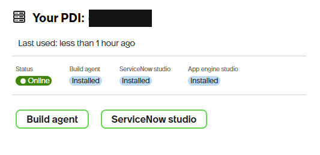
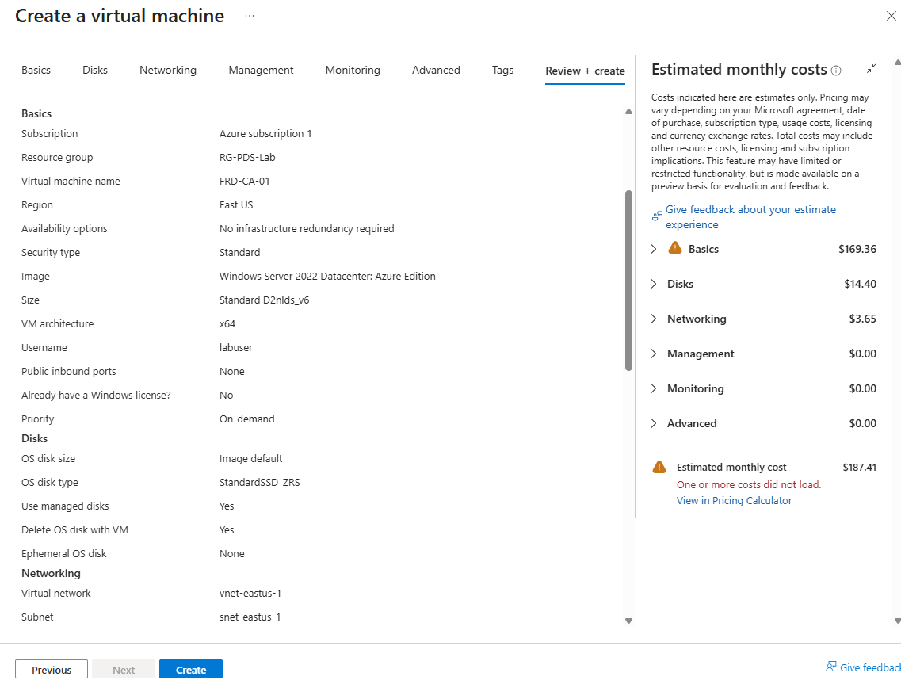
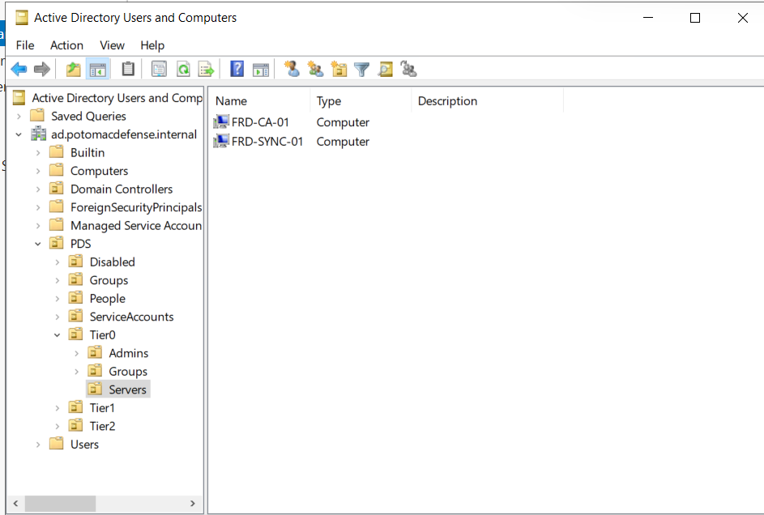

# Part 3.1: Design and Prep

**3.1** · [3.2 PKI →](../3.2-pki/README.md)

> **In this part:** I settled the design's open decisions, re-ordered the build so each part has what it depends on, worked out what the Azure subscription can actually run at once, and built the first new server: the certificate authority.
>
> **Design:** [`docs/01-design.md`](../../docs/01-design.md)

| # | Section | The lesson |
|---|---|---|
| 1 | [Decisions](#1-decisions) | One real app for SAML and provisioning |
| 2 | [Build order](#2-build-order) | The CA comes first, because everything else needs certificates |
| 3 | [Capacity](#3-capacity) | Stopped VMs still count against the quota |
| 4 | [The CA server](#4-the-ca-server) | Tier 0 from the moment it joins the domain |
| 5 | [Findings](#5-findings) | |

---

## 1. Decisions

| Decision | Choice | Why |
|---|---|---|
| **Application** | A **ServiceNow developer instance** (free personal instance) | A real enterprise app that supports SAML from both AD FS and Entra ID, and has an Entra provisioning connector. One app covers the migration and provisioning parts |
| **Provisioning** | Entra ID's **ServiceNow provisioning connector** | The design said SCIM. Entra's ServiceNow connector uses ServiceNow's **REST API**, not SCIM. The concepts are the same (scoping, attribute mapping, deprovisioning), and the write-up will say which protocol is really in use |
| **Test client** | A new domain-joined workstation, **`FRD-WS-01`** (Tier 2) | Testing AD FS and certificate sign-in needs a browser. Browsing from the DC or any Tier 0 server breaks the Project 1 tiering rules |
| **CRL location** | **Azure Blob Storage**, public read | Entra ID checks certificate revocation over the internet. An internal-only CRL would make certificate-based authentication impossible to test properly |



The instance name is redacted. Developer instances are reclaimed after a period of inactivity, so it needs a sign-in at least once a week until the project is done.

## 2. Build order

The first draft put AD FS first and the PKI near the end. But AD FS needs a TLS certificate from the CA, and certificate-based authentication needs the CA too. The revised order:

| Part | Builds | Depends on |
|:---:|---|---|
| 3.2 | PKI (AD CS) | Nothing new |
| 3.3 | AD FS, running as a gMSA | A TLS certificate from 3.2 |
| 3.4 | ServiceNow SAML sign-in through AD FS | 3.3 |
| 3.5 | Migrate ServiceNow to Entra ID, then decommission AD FS | 3.4 |
| 3.6 | OIDC and OAuth with PKCE | Entra ID only |
| 3.7 | Provisioning to ServiceNow | The Entra app from 3.5 |
| 3.8 | Certificate-based authentication and final review | The CA and CRL from 3.2 |

## 3. Capacity

The subscription has a limit of **10 vCPUs per region**. The DC and the sync server use 4.

Two things I learned checking the quota:
- **Stopped (deallocated) VMs still count** against the regional vCPU quota. Stopping VMs saves compute cost, but doesn't free quota
- **B-series VMs aren't available** on this subscription, so every new VM is a 2-vCPU **D2nlds_v6**

Three new servers (CA, AD FS, workstation) bring the total to exactly **10 of 10**. There's no room for a fourth, so anything else this project needs has to run on one of these or outside a VM.

## 4. The CA server

`FRD-CA-01`: Windows Server 2022, D2nlds_v6, **no public IP and no inbound ports from the internet**. Like the sync server, it's reached only through the DC.



It was joined to the domain straight into the Tier 0 servers OU, so Tier 0 policies apply from its first boot as a domain member:

```powershell
$cred = Get-Credential
Add-Computer -DomainName 'ad.potomacdefense.internal' `
  -OUPath 'OU=Servers,OU=Tier0,OU=PDS,DC=ad,DC=potomacdefense,DC=internal' -Credential $cred -Restart
```



Signing in afterwards only worked with the UPN (`t0-…@ad.potomacdefense.internal`), because the domain's NetBIOS name isn't the first label of the DNS name.

## 5. Findings

| # | Finding | Impact | Fix |
|---|---|---|---|
| 1 | **Entra's ServiceNow connector uses REST, not SCIM** | The design assumed SCIM | Documented. The provisioning part covers the same lifecycle either way |
| 2 | **Deallocated VMs count against the vCPU quota** | Capacity planning based on "running" VMs is wrong | Plan against total vCPUs. Request a quota increase in production |

## What I had at the end of 3.1

- [x] Open decisions settled: application, provisioning, test client, CRL location
- [x] A build order that respects dependencies
- [x] A capacity plan that fits the quota
- [x] `FRD-CA-01` built and domain-joined into Tier 0

---

**Next:** [3.2 PKI →](../3.2-pki/README.md) · [← Back to the project overview](../../README.md)
