# Part 3.2: PKI (Active Directory Certificate Services)

[← 3.1 Design and Prep](../3.1-design-and-prep/README.md) · **3.2** · 3.3 AD FS (next)

> **In this part:** I built PDS's certificate authority, `PDS-Root-CA`. It issues nothing until a certificate type is chosen on purpose, it audits everything it does, and its revocation list is published to the internet every day by a managed identity, with no storage key anywhere.
>
> **Scripts:** [`3.2-CAPolicy.inf`](../../scripts/3.2-CAPolicy.inf) · [`3.2-install-and-configure-ca.ps1`](../../scripts/3.2-install-and-configure-ca.ps1) · [`3.2-Publish-CRL.ps1`](../../scripts/3.2-Publish-CRL.ps1)

| # | Section | The lesson |
|---|---|---|
| 1 | [Where the revocation list lives](#1-where-the-revocation-list-lives) | HTTP on purpose |
| 2 | [Enterprise Admin, temporarily](#2-enterprise-admin-temporarily) | The most powerful group in the forest, for one install |
| 3 | [Rules before the install](#3-rules-before-the-install) | A new CA would issue 11 certificate types on day one |
| 4 | [Installing the CA](#4-installing-the-ca) | |
| 5 | [Addresses, lifetime and auditing](#5-addresses-lifetime-and-auditing) | Set before the first certificate, or it's baked in wrong |
| 6 | [Publishing with a managed identity](#6-publishing-with-a-managed-identity) | No key on a Tier 0 server |
| 7 | [Automating it, then removing the keys](#7-automating-it-then-removing-the-keys) | |
| 8 | [Findings](#8-findings) | |

---

## 1. Where the revocation list lives

Every certificate the CA issues carries the address of its **certificate revocation list (CRL)**: the signed list of certificates that have been cancelled. Anything checking a PDS certificate has to download that list. That includes Entra ID, which checks from the internet when someone signs in with a certificate.

So the CRL goes in an Azure Storage account, `pdspki9876`, in a container called `pki`:

| Setting | Value | Why |
|---|---|---|
| Require secure transfer | **Off** | CRLs are read over **plain HTTP**. Checking a certificate over HTTPS would need a certificate check of its own. The CRL is signed by the CA, so it can't be altered without detection |
| Anonymous access | Allowed per container | The CRL is public by design |
| Container access level | **Blob** | Anyone can read a file if they know its exact name, but nobody can list the container |
| Minimum TLS | 1.2 | Uploads still use HTTPS |

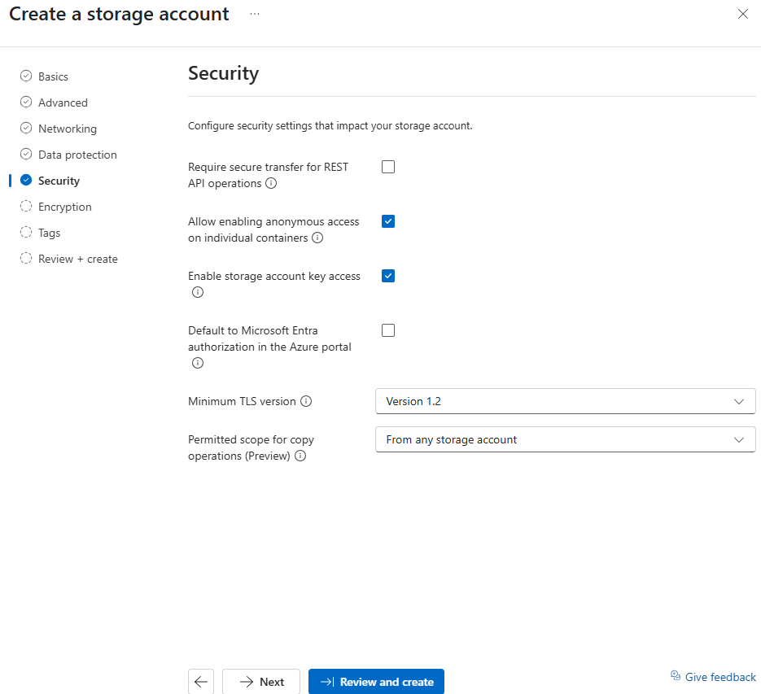

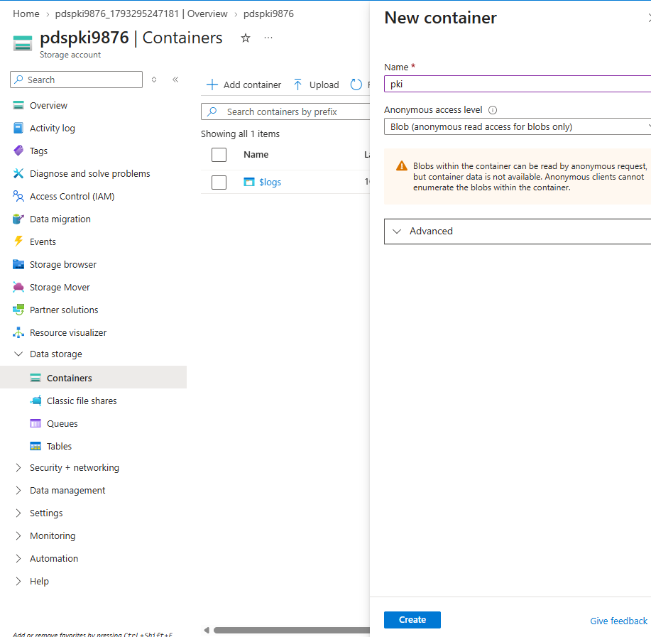

## 2. Enterprise Admin, temporarily

An **enterprise** CA (one integrated with Active Directory) writes to the forest-wide configuration, which requires **Enterprise Admins**. I added my Tier 0 account for the install only:

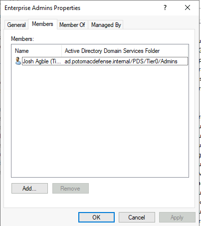

It was removed at the end of this part ([section 7](#7-automating-it-then-removing-the-keys)). The group is now **empty**, which is the recommended state: no one holds forest-wide admin rights all the time.

## 3. Rules before the install

Windows reads `C:\Windows\CAPolicy.inf` once, during installation. Some of what it sets is hard to change afterwards.

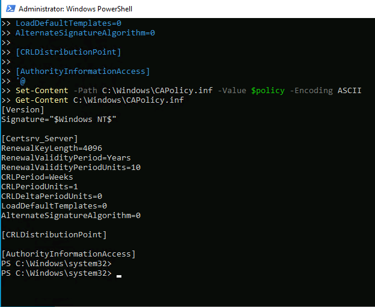

| Setting | What it does |
|---|---|
| `LoadDefaultTemplates=0` | **The one that matters most.** By default a new enterprise CA starts issuing about 11 certificate types straight away, some of which any domain user can request. Misconfigured certificate templates are a well-known route to domain compromise. With this set, the CA can't issue anything until I add a template on purpose |
| `CRLPeriod=Weeks`, `CRLPeriodUnits=1` | A new CRL every week |
| `CRLDeltaPeriodUnits=0` | No delta CRLs: one file to publish |
| `RenewalKeyLength=4096`, 10 years | Applies when the root certificate is renewed |
| Empty `[CRLDistributionPoint]` and `[AuthorityInformationAccess]` | The root certificate itself carries no addresses. A root is trusted directly, so it doesn't need them |

## 4. Installing the CA

An enterprise root CA called **`PDS-Root-CA`**: 4096-bit RSA key, SHA-256, 10-year root certificate.

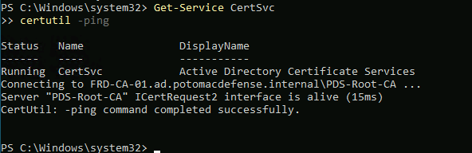

**The template list is empty.** `LoadDefaultTemplates=0` worked:

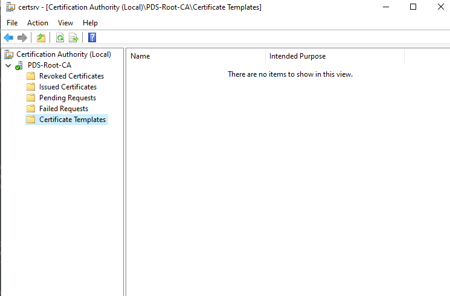

## 5. Addresses, lifetime and auditing

The CRL and CA certificate addresses get stamped into every certificate the CA issues. Nothing had been issued yet, so this was the time to get them right.

| Setting | Default | Changed to | Why |
|---|---|---|---|
| CRL address (CDP) | An LDAP path and `http://<CA server>` | `http://pdspki9876.blob.core.windows.net/pki/PDS-Root-CA.crl` | Neither default is reachable from the internet, so Entra ID couldn't check revocation |
| CA certificate address (AIA) | Same | `…/pki/PDS-Root-CA.crt` | Lets clients download the CA certificate to build the chain |
| Certificate lifetime | 2 years | **1 year** | Sign-in certificates should be short-lived |
| Auditing | Off | **All 7 categories**, plus the Windows audit policy for Certification Services | A CA logs almost nothing by default. Both settings are needed: one tells the CA what to audit, the other tells Windows to record it |

The local `CertEnroll` folder is still where the CA writes its files, but it isn't put in certificates:

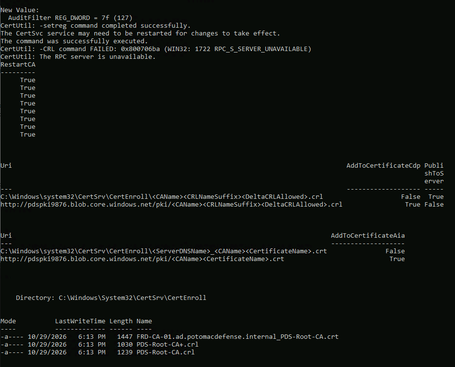

**What went wrong:** `certutil -crl` failed with *"The RPC server is unavailable"* because it ran a second after `Restart-Service`, before the CA had finished starting. A fresh CRL published fine on the second try. The script now waits 15 seconds. I also found a `PDS-Root-CA+.crl` (a delta CRL) in the folder, and confirmed delta CRLs are off (`CRLDeltaPeriodUnits = 0`). The file was left over from installation.

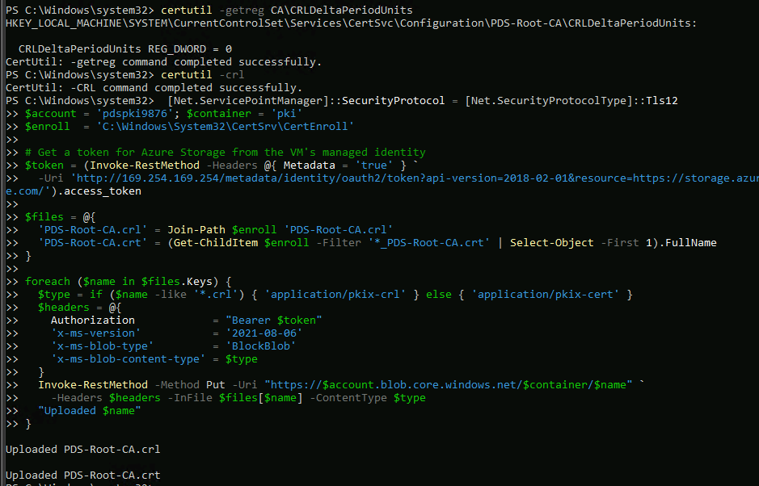

## 6. Publishing with a managed identity

The CRL has to get from the CA to the storage account. The easy way would be a storage key on the CA. But that's a long-lived secret sitting on a Tier 0 server, and anyone with it could overwrite the CRL.

Instead, the CA VM has a **system-assigned managed identity**, the same approach as the metrics runbook in [Project 2](https://github.com/jagble/zero-trust-iam-lab/blob/HEAD/parts/2.8-non-human-identities/README.md#4-the-managed-identity):

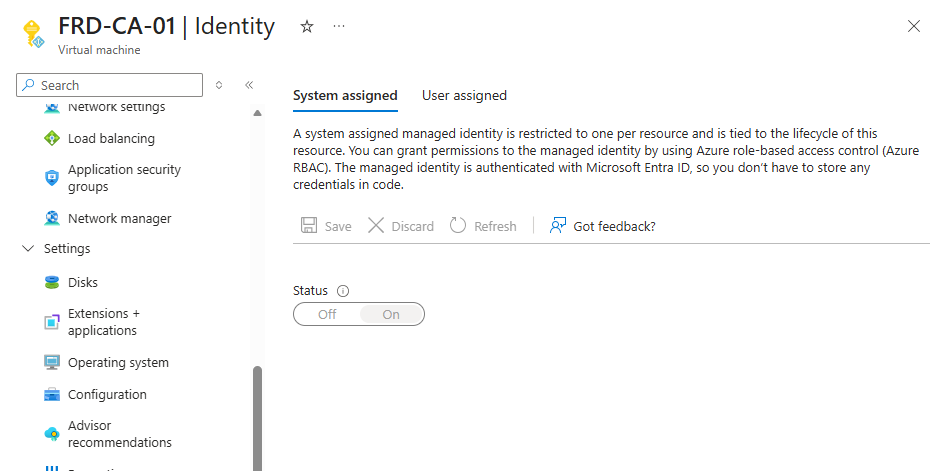

It has **Storage Blob Data Contributor on the `pki` container only**, not the whole storage account:

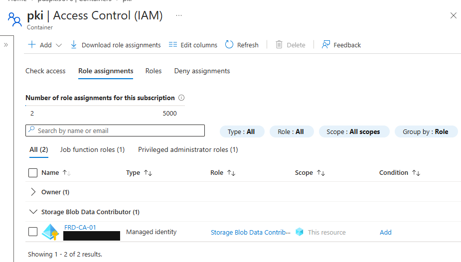

The upload script asks the VM's local metadata endpoint for a short-lived token, then uploads the CRL and CA certificate over HTTPS:

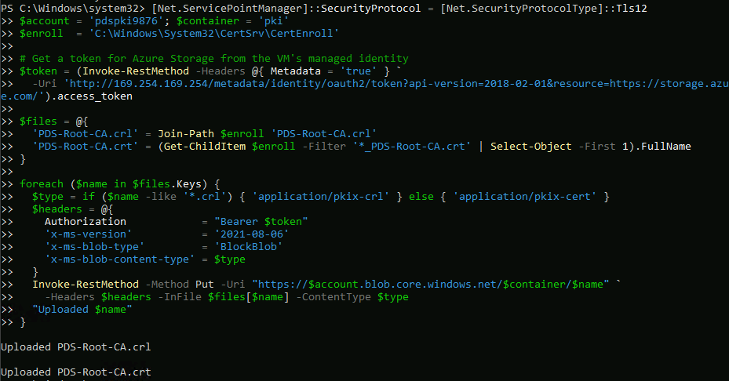

**Tested from outside:** the CRL downloads over HTTP from my own PC and opens with issuer `PDS-Root-CA` and a next update one week out:

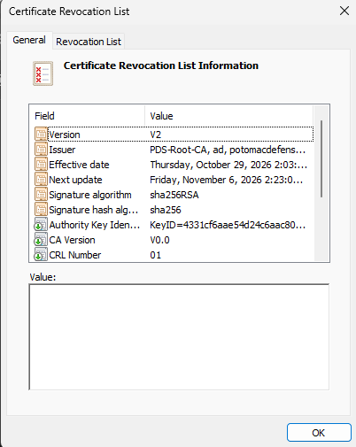

## 7. Automating it, then removing the keys

The CA publishes a new CRL every week by itself. A scheduled task uploads it **every day at 6 AM**, running as SYSTEM, so the internet copy is never more than a day old. The script and its log are in `C:\PKI`, which is restricted to SYSTEM and Administrators. The task runs as SYSTEM, so if anyone else could edit the script, they could get SYSTEM to run their code.

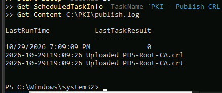

With the managed identity working, nothing needs the storage account keys, so I **turned off storage account key access**. The only way to write to the account now is through Entra ID.

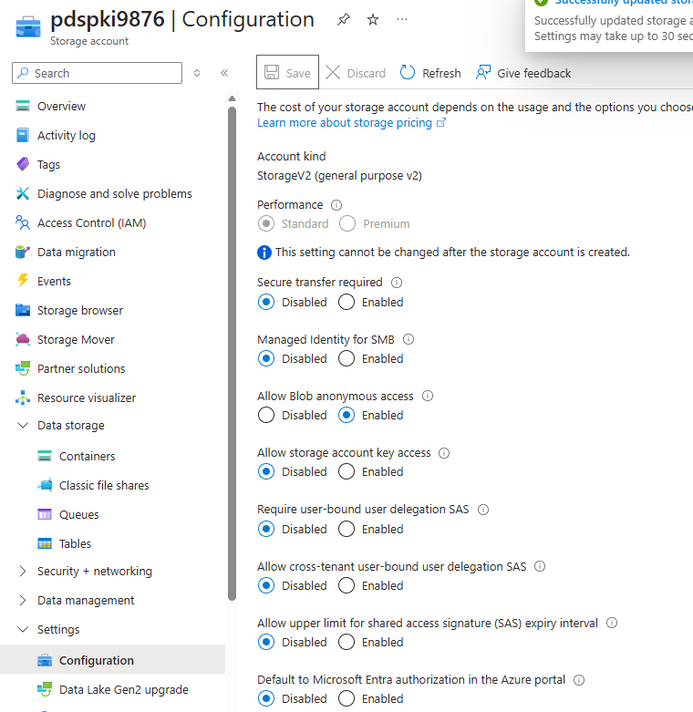

Both still work: the CRL downloads publicly (now CRL number 03), and the task uploads with keys off:

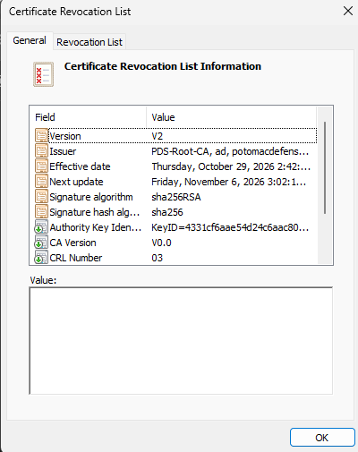

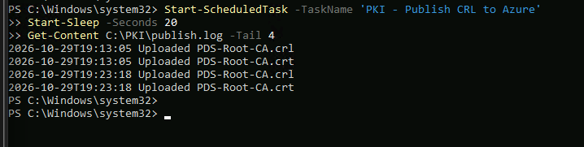

Finally, my Tier 0 account was removed from Enterprise Admins:

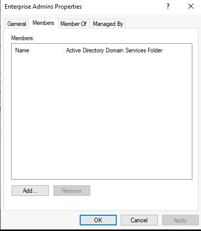

## 8. Findings

| # | Finding | Impact | Fix |
|---|---|---|---|
| 1 | **A new enterprise CA publishes about 11 certificate templates by default**, some open to every domain user | Certificate types nobody chose become issuable on day one, a known route to domain compromise | `LoadDefaultTemplates=0` (done). Each template added later gets its permissions reviewed |
| 2 | **The default CRL and AIA addresses aren't reachable from the internet** | Entra ID couldn't check whether a certificate was revoked | Public HTTP address in Blob Storage (done) |
| 3 | **CA auditing is off by default** | Issuing, revoking or reconfiguring leaves almost no trace | All categories on, plus the audit policy (done). Forwarding to Log Analytics: open |
| 4 | **Installing an enterprise CA requires Enterprise Admins** | A standing membership would be forest-wide admin all the time | Granted for the install, removed after. The group is empty (done) |
| 5 | **Uploading the CRL the easy way means a storage key on a Tier 0 server** | A stolen key could replace the CRL | Managed identity scoped to one container. Storage keys disabled (done) |
| 6 | **"Secure transfer required" has to be off for HTTP CRL reads, and it's account-wide** | HTTP would be allowed for anything else stored in the account | The account holds only public PKI files. Writes use HTTPS and Entra ID only |
| 7 | **The CA runs online, as a single tier, with its key in software** | Compromising this one server compromises the whole PKI | Accepted for the lab. Production: offline root, separate issuing CA, key in an HSM |
| 8 | **Nothing alerts if the daily upload fails** | The CRL expires in about a week, then every PDS certificate check fails | Alert on failures in `publish.log`, or on the CRL's age (open) |

## Test results

| Test | Result |
|---|---|
| CA installed, service running, answers requests | ✅ |
| No certificate templates published | ✅ |
| New certificates will carry the public CRL and AIA addresses | ✅ |
| CRL readable from the internet | ✅ CRL number 03, next update in 1 week |
| CRL uploads with a managed identity and no stored key | ✅ Including after storage keys were disabled |
| Daily upload task | ✅ Result 0, logged |
| Enterprise Admins empty afterwards | ✅ |

## What I had at the end of 3.2

- [x] `PDS-Root-CA`, issuing nothing until a template is added on purpose
- [x] Auditing on
- [x] A public CRL, refreshed daily by a managed identity
- [x] No storage keys and no standing Enterprise Admins

---

**Next:** 3.3 AD FS · [← Back to the project overview](../../README.md)
