# Part 3.3: AD FS

[← 3.2 PKI](../3.2-pki/README.md) · **3.3** · 3.4 SAML on AD FS (next)

> **In this part:** I built the "legacy" starting point for the migration: an AD FS federation server, treated as Tier 0 from the start. It runs as a gMSA nobody knows the password to, uses a TLS certificate from my own CA (issued from a locked-down template), audits every sign-in, and passed its first federated sign-in from a Tier 2 workstation.
>
> **Scripts:** [`3.3-adfs-prereqs.ps1`](../../scripts/3.3-adfs-prereqs.ps1) · [`3.3-request-adfs-certificate.ps1`](../../scripts/3.3-request-adfs-certificate.ps1) · [`3.3-install-adfs.ps1`](../../scripts/3.3-install-adfs.ps1)

**What AD FS is:** a server that lets people sign in to apps outside the domain with their AD account. The app sends the user to AD FS, AD FS checks them against AD and returns a **signed token**, and the app trusts the token. Many organizations still run it, and moving apps off it to Entra ID is a common project. That's what parts 3.3 to 3.5 recreate.

**Why it's Tier 0:** AD FS signs tokens with a **token-signing certificate**. Whoever steals its private key can mint a valid token for any user, including admins, without a password or MFA. That's a **Golden SAML** attack, and it was used in the SolarWinds breach.

| # | Section | The lesson |
|---|---|---|
| 1 | [Two new servers](#1-two-new-servers) | A public IP I didn't mean to add |
| 2 | [Service account, enrollment group and DNS](#2-service-account-enrollment-group-and-dns) | |
| 3 | [The CA's first certificate template](#3-the-cas-first-certificate-template) | The setting attackers look for, and three ways to defuse it |
| 4 | [Requesting the TLS certificate](#4-requesting-the-tls-certificate) | The first certificate to check its own revocation over the internet |
| 5 | [Installing AD FS](#5-installing-ad-fs) | AD FS only looks for its gMSA in one place |
| 6 | [Auditing](#6-auditing) | |
| 7 | [First sign-in](#7-first-sign-in) | |
| 8 | [Findings](#8-findings) | |

---

## 1. Two new servers

| Server | Role | Tier | OU |
|---|---|:---:|---|
| `FRD-ADFS-01` | AD FS | 0 | `Tier0\Servers` |
| `FRD-WS-01` | Test workstation, the only machine in this project where a browser is used | 2 | `Tier2\Workstations` |

Both are D2nlds_v6 with auto-shutdown at 7 PM, bringing the subscription to exactly its 10-vCPU limit. The workstation runs Windows Server 2022, because Windows 11 images in Azure need separate licensing. For testing sign-in in a browser it behaves the same.

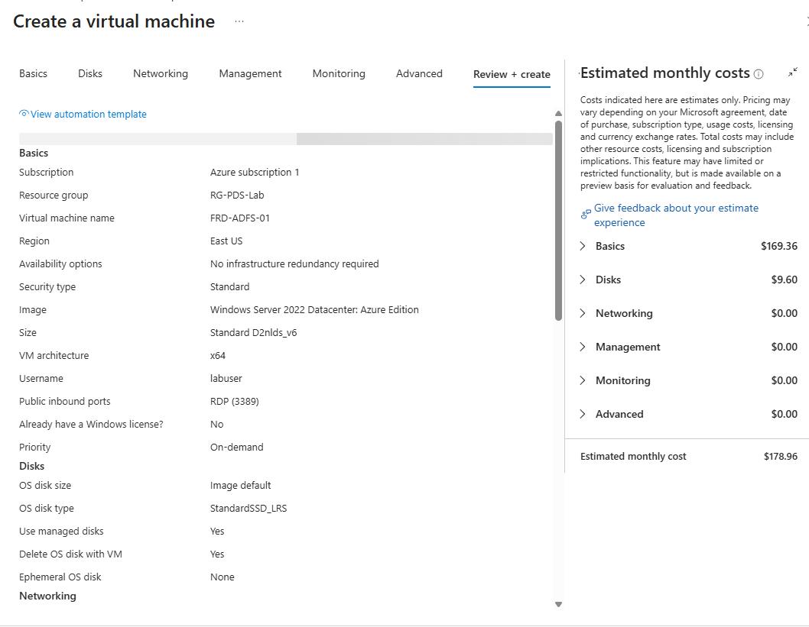

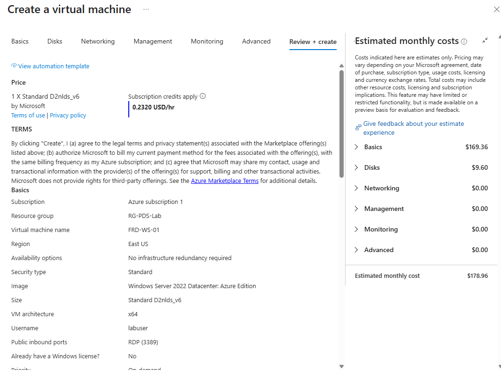

**What went wrong:** both review pages show **Public inbound ports: RDP (3389)**, and FRD-ADFS-01 was created with a public IP. Neither VM had a network security group, and a Standard public IP blocks all inbound traffic unless an NSG allows it, so RDP was never actually reachable. I removed the public IP anyway: a Tier 0 server shouldn't have an internet address that a single rule could expose.

Each server joined the domain straight into its tier's OU:

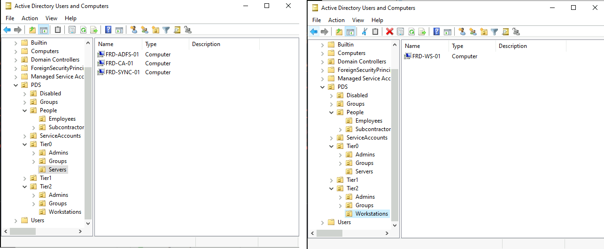

## 2. Service account, enrollment group and DNS

| Object | Purpose |
|---|---|
| **`gmsa-adfs`** | AD FS's service account, a **group managed service account**. AD generates and rotates its password, and only `FRD-ADFS-01` can retrieve it, so no person ever knows it. SPN `http/sts.ad.potomacdefense.internal` |
| **`T0-PKI-WebServer-Enroll`** | The only group allowed to request web server certificates. One member: `FRD-ADFS-01` |
| **`sts.ad.potomacdefense.internal`** | The federation service name. An **A record, not a CNAME**, so Kerberos asks for the right name |

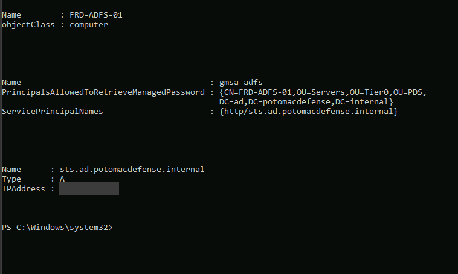

**Start-of-session check:** the CA only runs during work sessions, so its 6 AM CRL upload was being skipped. The CRL would have expired on Nov 6 and broken every certificate check, including this part's. I set the task to **run as soon as possible after a missed start**, published a fresh CRL and uploaded it:

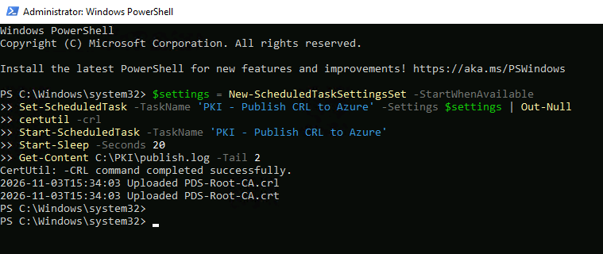

## 3. The CA's first certificate template

In 3.2, the CA was set up to issue **nothing** by default. AD FS needs a TLS certificate, so this is the first template, and certificate templates are where most AD CS attacks start.

**The risky setting:** the template has to allow **"Supply in the request"**, because the server supplies its own name (`sts.…`). If a template lets the requester choose the name **and** the certificate can be used to sign in, anyone who can enroll can get a certificate as any user, including a Domain Admin. Three settings close that off:

| Setting | Value | Why |
|---|---|---|
| Application policies | **Server Authentication only** | A certificate that can't be used for sign-in can't impersonate a user |
| Enrollment | **`T0-PKI-WebServer-Enroll` only** (Read + Enroll) | Authenticated Users can read the template but not enroll |
| Issuance | **CA certificate manager approval** | Every request waits until someone approves it on the CA |
| Private key export | Not allowed | One AD FS server, so the key never needs to leave it |
| Validity | 1 year | |

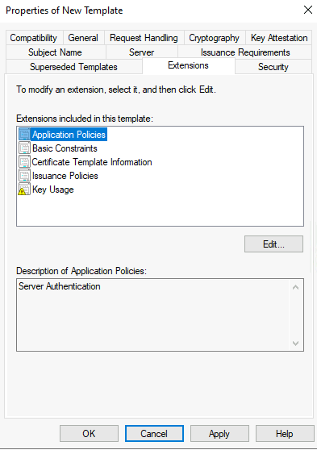

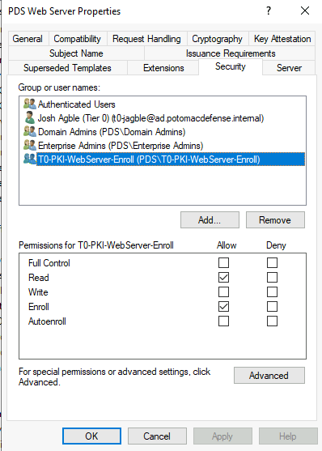

`PDSWebServer` is the only template the CA issues:

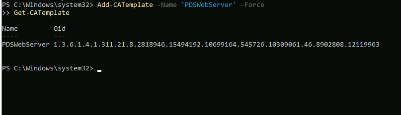

## 4. Requesting the TLS certificate

The request came from the server's own computer account and stopped at **Pending**, so manager approval works:

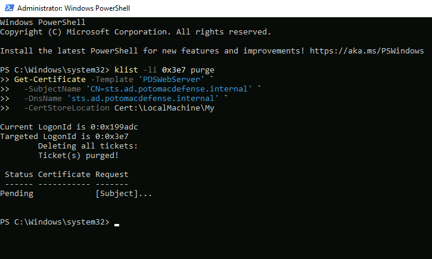

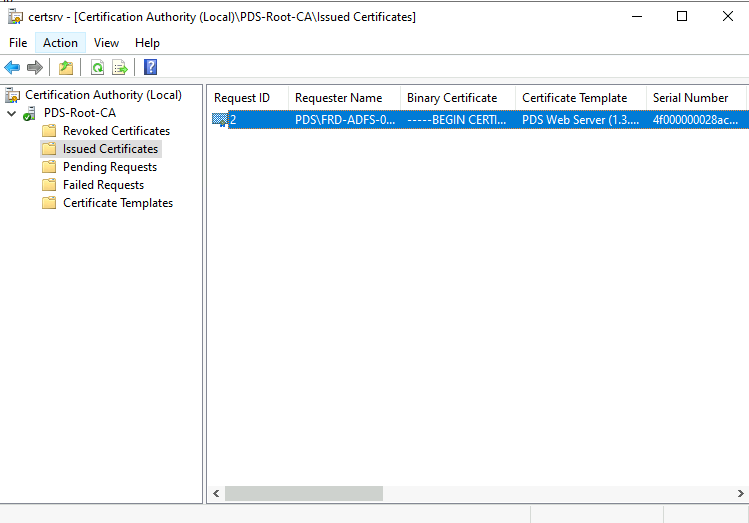

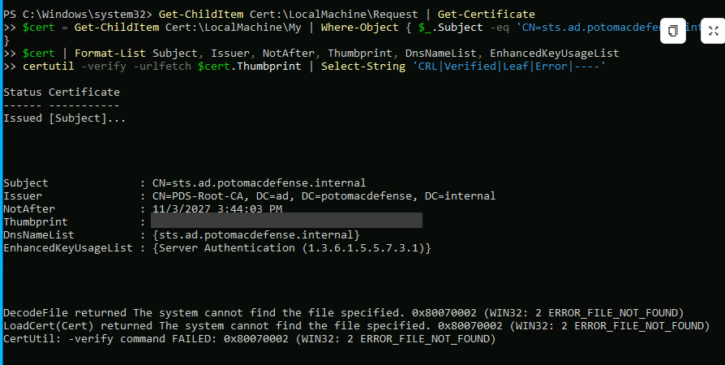

**The end-to-end check:** `certutil -verify -urlfetch` built the chain and **downloaded the CA certificate and CRL from Blob Storage**, the addresses stamped into the certificate in 3.2. *"Leaf certificate revocation check passed"* is the first time a PDS certificate checked its own revocation status over the internet.

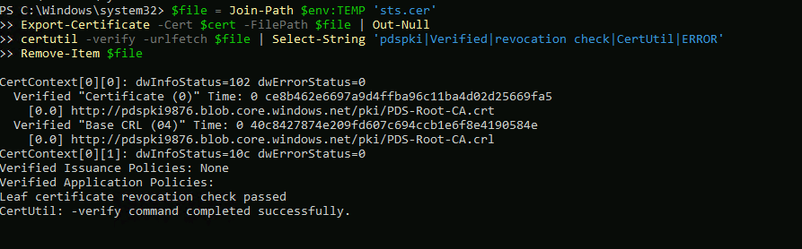

## 5. Installing AD FS

The first install failed:

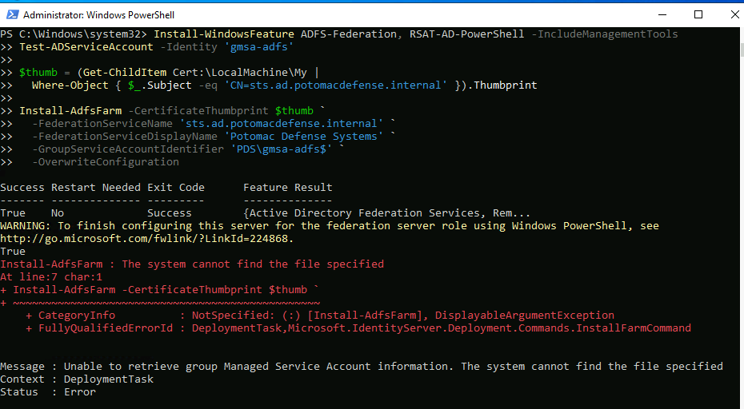

`Test-ADServiceAccount` said **True**, so the server could retrieve the gMSA's password. A restart and `Install-ADServiceAccount` didn't help. The cause: I'd created the gMSA in my `PDS\ServiceAccounts` OU, but **AD FS only looks for its gMSA in the default `Managed Service Accounts` container**. Moving it fixed the install:

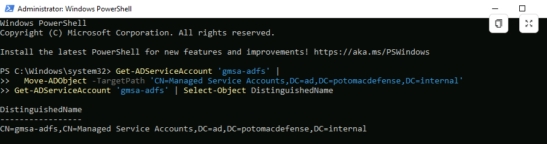

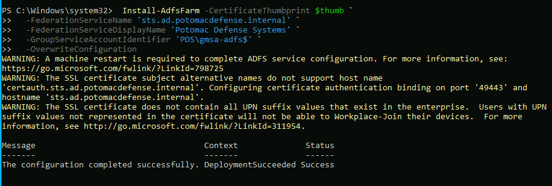

| Install warning | Meaning |
|---|---|
| Restart required | Done. `adfssrv` is a delayed-start service, so it showed Stopped right after the restart and I started it by hand |
| No `certauth.sts…` name on the certificate | Only needed for signing in to AD FS with a certificate. In this project, certificate sign-in happens in Entra ID (3.8) |
| Not every UPN suffix is on the certificate | Only affects Workplace Join, which isn't used |

**What was created:** the service, plus three certificates. Service-Communications is mine from the CA. **Token-Signing** and **Token-Decrypting** were generated by AD FS, are self-signed, last a year, and **roll over automatically**. The token-signing key is the Golden SAML target.

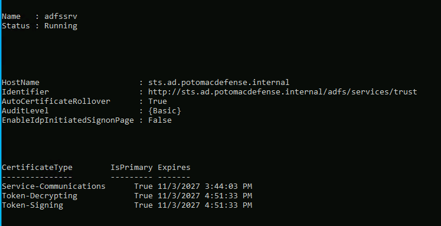

## 6. Auditing

AD FS defaults to **Basic** auditing, and Windows doesn't keep its events until the "Application Generated" audit policy is on. Like the CA in 3.2, it takes both settings:

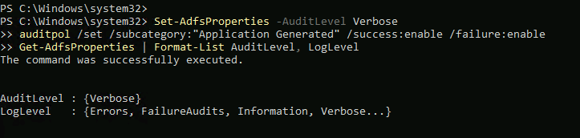

## 7. First sign-in

From `FRD-WS-01`, signed in as a local user:

**The federation metadata downloaded over HTTPS with no warning.** This is the signed file an app reads to trust AD FS: its identifier (`entityID`) and the public half of the token-signing certificate. ServiceNow will use it in 3.4.

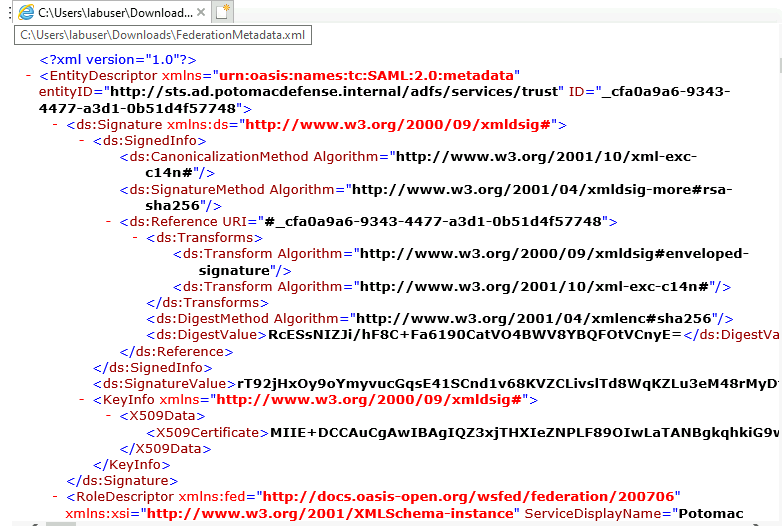

**The sign-in page loaded with a valid certificate.** The workstation got PDS-Root-CA from Active Directory, so nothing had to be installed by hand:

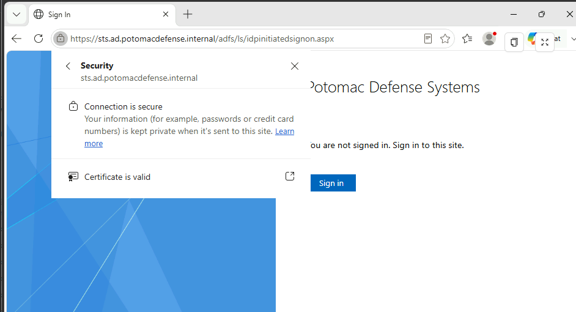

I turned on AD FS's test sign-in page (`EnableIdpInitiatedSignonPage`) **only for this test** and signed in as a regular user, Monica Hayes:

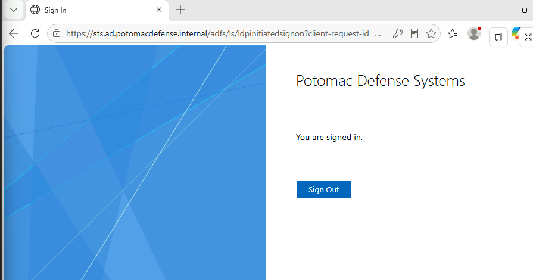

**The audit trail shows the whole attempt:** two **failed** attempts (1203) while I tried her cloud email address as the username, then credentials validated (1202) and a token issued (1200) with `PDS\monica.hayes`. Then the test page was turned off again:

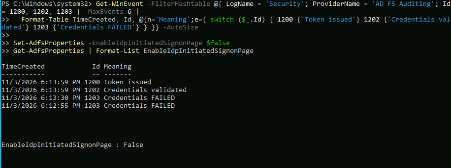

## 8. Findings

| # | Finding | Impact | Fix |
|---|---|---|---|
| 1 | **Both VMs were created with RDP selected, and the AD FS server with a public IP** | Not reachable (no NSG allowed it), but one added rule would have exposed a Tier 0 server | Public IP removed (done). Production: an Azure Policy that denies public IPs on Tier 0 subnets |
| 2 | **AD FS requires its gMSA in the default `Managed Service Accounts` container** | Breaks a tiered OU design. Anyone who can change who may retrieve the gMSA's password can take over AD FS | Moved (done). That container needs Tier 0 protection: restrict and monitor writes to it (open) |
| 3 | **The web server template must allow the requester to supply the name** | The classic template misconfiguration that lets any enrollee become any user | Server Authentication only, enrollment limited to one group, manager approval (done) |
| 4 | **A template's creator is automatically given permissions on it** | Extra permissions nobody chose | Review template permissions after creation (open) |
| 5 | **AD FS auditing is Basic by default, and Windows discards it without the audit policy** | Sign-ins through AD FS leave little trace | Verbose plus the audit policy (done). Forwarding to Log Analytics (open) |
| 6 | **The test sign-in page is an attack surface** | Anyone can reach a sign-in form, and it can reveal connected apps | On only for the test, then off (done) |
| 7 | **The token-signing key lives on this server, protected by a key stored in AD** | A Tier 0 compromise means Golden SAML: tokens for any user | Tier 0 only, auditing on, and the end goal is decommissioning AD FS (3.5) |
| 8 | **The user's cloud email address didn't work as an AD FS username** | Her AD UPN differs from her cloud UPN, which matters for which claim identifies her to ServiceNow | Check the AD UPN and choose the identifier claim in 3.4 (open) |

## Test results

| Test | Result |
|---|---|
| Certificate request needs approval | ✅ Pending until issued |
| TLS certificate chains to PDS-Root-CA and passes revocation over the internet | ✅ |
| AD FS runs as a gMSA | ✅ |
| Workstation trusts the federation service with no manual certificate install | ✅ |
| A domain user signs in through AD FS | ✅ |
| Successful and failed sign-ins are audited | ✅ 1200, 1202 and 1203 events |
| Test sign-in page off after testing | ✅ |

## What I had at the end of 3.3

- [x] AD FS running in Tier 0 as a gMSA, with a TLS certificate from my own CA
- [x] A locked-down web server template: server authentication only, one group, manager approval
- [x] Every AD FS sign-in audited
- [x] A working federated sign-in, ready for ServiceNow in 3.4

---

**Next:** 3.4 SAML on AD FS · [← Back to the project overview](../../README.md)
