# Part 3.4: ServiceNow SAML Sign-In Through AD FS

[← 3.3 AD FS](../3.3-adfs/README.md) · **3.4** · 3.5 Migrate to Entra ID (next)

> **In this part:** I connected ServiceNow to AD FS over SAML 2.0, the "before" state that 3.5 migrates to Entra ID. A group decides who gets in, users are identified by an attribute that won't change during the migration, and both an allowed and a refused sign-in are proven in the AD FS audit log.
>
> **Script:** [`3.4-servicenow-relying-party.ps1`](../../scripts/3.4-servicenow-relying-party.ps1)

**How SAML sign-in works here:** ServiceNow is in the cloud and AD FS is internal, but they never talk to each other directly. The **browser** carries everything. ServiceNow sends the user to AD FS, AD FS checks them against AD and gives the browser a **signed token** (a SAML assertion), and the browser posts it back to ServiceNow, which checks the signature and signs the user in.

| # | Section | The lesson |
|---|---|---|
| 1 | [Choosing the identifier](#1-choosing-the-identifier) | The UPN would have broken the migration |
| 2 | [Who's allowed in](#2-whos-allowed-in) | |
| 3 | [ServiceNow side](#3-servicenow-side) | |
| 4 | [AD FS side: the relying party trust](#4-ad-fs-side-the-relying-party-trust) | |
| 5 | [Getting SSO to switch on](#5-getting-sso-to-switch-on) | Three blockers, none of them in the token |
| 6 | [Testing: allowed and refused](#6-testing-allowed-and-refused) | |
| 7 | [Findings](#7-findings) | |

---

## 1. Choosing the identifier

The app needs one value in the token that says who the user is. I checked Monica's AD attributes first:

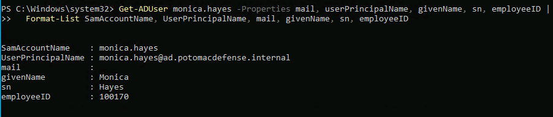

| Option | Problem |
|---|---|
| **UPN** | Her AD UPN is `monica.hayes@ad.potomacdefense.internal`. `.internal` can't be registered on the internet, so Entra Connect gave her a different cloud UPN (`@PotomacDefenseSystems.onmicrosoft.com`). An app that matched users on UPN would see **every user as someone new** after the move to Entra in 3.5 |
| **Email** | `mail` is **empty**. The Project 1 JML engine never set it |
| **employeeID** | `100170`. Identical in AD and Entra, never changes, and already the matching key everywhere else in this portfolio. **Chosen** |

So AD FS sends **employeeID as the SAML Name ID**, and ServiceNow matches it to the user's **Employee number**.

## 2. Who's allowed in

A new AD group, `GG-App-ServiceNow`, with one member. It syncs to Entra, so the same group will control access after the migration (3.5) and decide who gets provisioned (3.7).

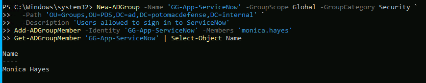

## 3. ServiceNow side

I replaced the original developer instance before configuring anything: it stopped responding (stuck offline, HTTP 502). The instance name is redacted in every screenshot.

**Multi-Provider SSO plugin**, which adds SAML and keeps a local admin login available:

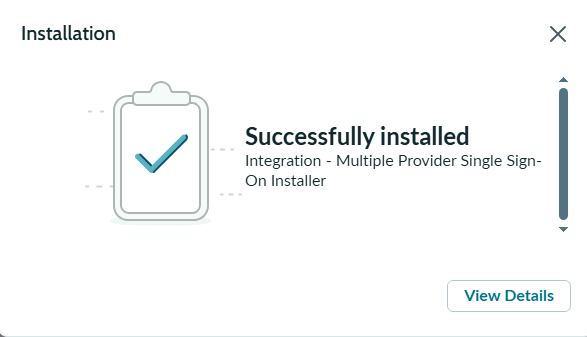

**Monica's ServiceNow account**, created by hand for now with **Employee number 100170** and no password. Provisioning will create accounts automatically in 3.7:

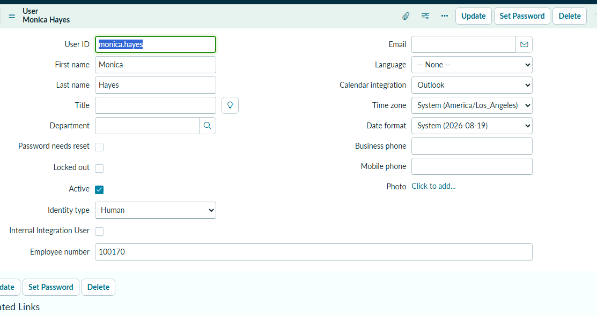

**AD FS as an identity provider.** I pasted AD FS's federation metadata, which filled in its identifier, sign-in URL and **token-signing certificate**, the certificate ServiceNow uses to check every token. Then I set the Name ID format to *unspecified* and the user field to `employee_number`:

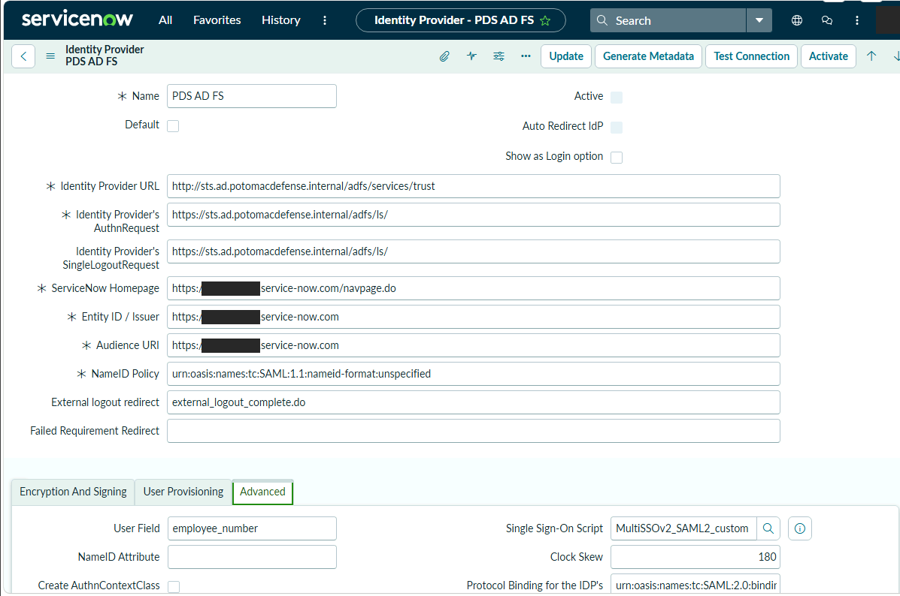

## 4. AD FS side: the relying party trust

I created the trust from **ServiceNow's metadata file**, which set its identifier, the URLs tokens get posted to, and its signing certificate without anything typed by hand.

| Setting | Value |
|---|---|
| Access control | **Permit specific group: `GG-App-ServiceNow`**. Everyone else is refused by AD FS, and ServiceNow never sees a token |
| Claim rule 1 | Look up the user in AD and issue employeeID, given name and surname |
| Claim rule 2 | Copy employeeID into the **Name ID**, format *unspecified* |

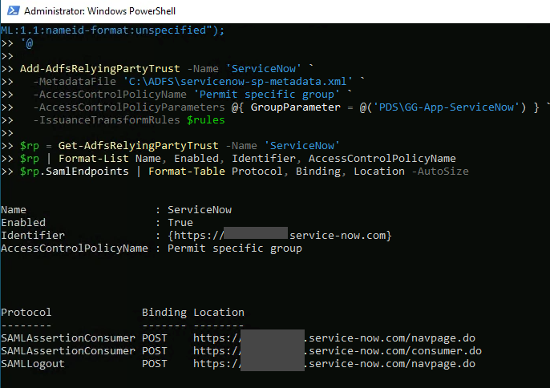

## 5. Getting SSO to switch on

The first sign-in attempts ended on ServiceNow's own login page, even though AD FS was issuing tokens every time (event 1200). With debug logging on, ServiceNow's log showed it **received and parsed the response** and recognized our AD FS as the issuer:

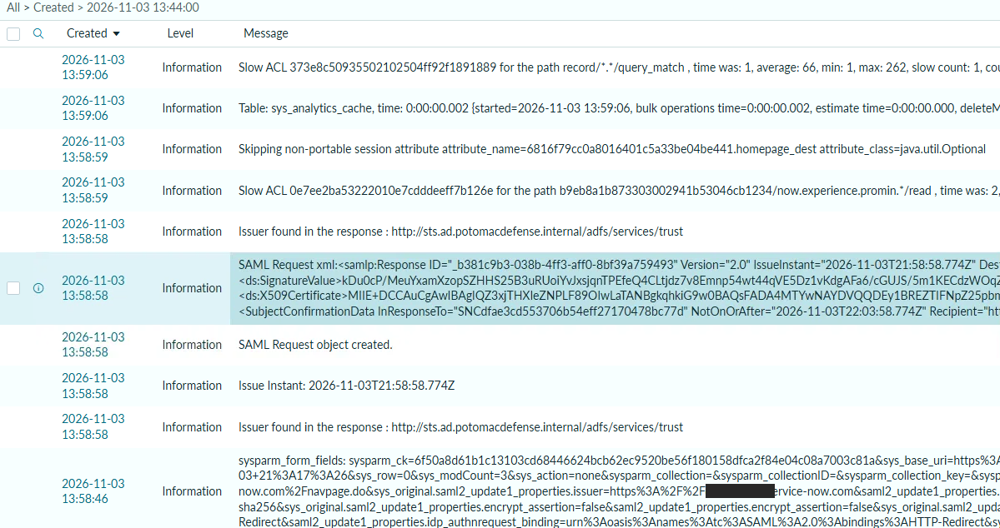

So the token was fine. Three things on ServiceNow's side were in the way:

**1. SSO's master switch was off, and ServiceNow wouldn't let me turn it on** until an admin was set up for **account recovery**: a local sign-in protected by **MFA**, kept for when SSO breaks. That's the same break-glass idea as the Entra emergency account in Project 2. I enrolled the admin with an authenticator app, then enabled multi-provider SSO:

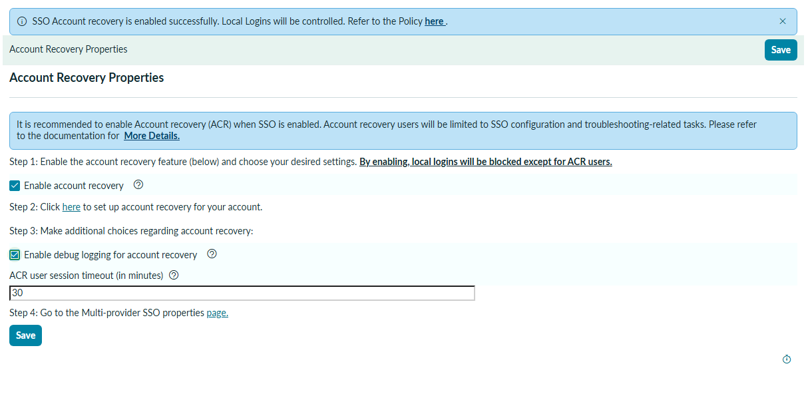

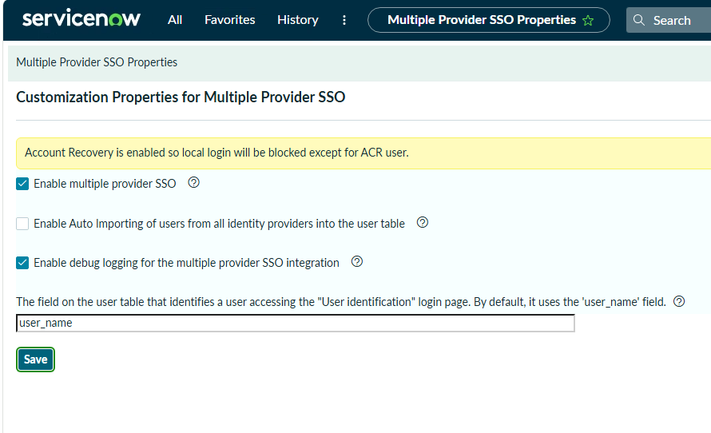

**2. The recovery session is restricted.** After this, the admin's local sign-in counts as account recovery, which is limited to SSO tasks. It couldn't filter the system log or create a system property. Making changes outside SSO meant briefly turning multi-provider SSO and account recovery off, then back on.

**3. ServiceNow's Test Connection never completed.** ServiceNow won't activate an identity provider until its built-in test passes. Three attempts ended on a login page or the home page, never on a results page. AD FS here is internal only, and ServiceNow documents a property for identity providers whose built-in test can't pass. I set `glide.authenticate.multisso.test.connection.mandatory` to **false**, activated, and **proved sign-in with real users instead**. A real sign-in checks everything the test does: the signature, the issuer, the audience, the time limits and the user lookup. The requirement goes back to **true** in 3.5, when the identity provider is Entra ID and reachable from the internet.

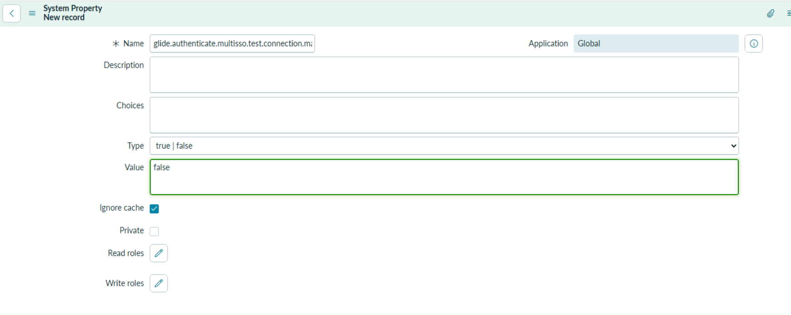

## 6. Testing: allowed and refused

**Allowed:** Monica signed in through AD FS and landed in ServiceNow as herself. AD FS sent `100170`, and ServiceNow found her by Employee number:

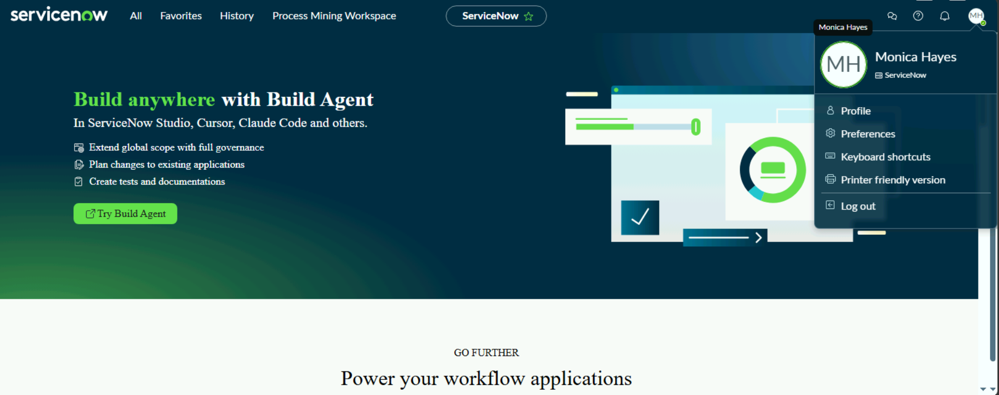

**Refused:** Chris has a valid AD password but isn't in `GG-App-ServiceNow`. ServiceNow showed only a generic error:

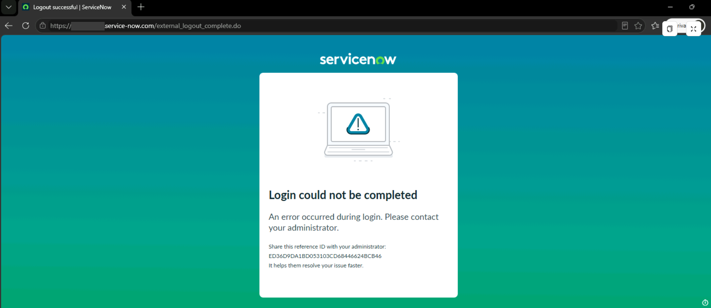

**The AD FS audit log shows who stopped him:**

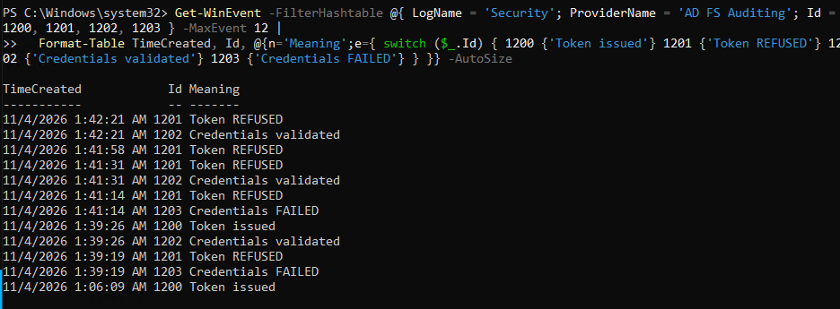

| Time (server, UTC) | Events | What happened |
|---|---|---|
| 1:39:19 | 1203, 1201 | A wrong password, rejected |
| **1:39:26** | **1202, 1200** | **Monica: password checked, token issued** |
| 1:41:14 | 1203, 1201 | A wrong password, rejected |
| **1:41:31 · 1:42:21** | **1202, 1201** | **Chris: password correct, token refused** by the access policy |
| 1:41:58 | 1201 | Chris retrying with his AD FS session, refused again |

The refusal happens **at AD FS**, before ServiceNow is involved. After testing, SSO debug logging was turned off, since it records full token contents.

## 7. Findings

| # | Finding | Impact | Fix |
|---|---|---|---|
| 1 | **AD UPNs use a non-routable suffix (`.internal`), so every user's cloud UPN is different** | Any app keyed on UPN loses its users when it moves from AD FS to Entra | Identify users by employeeID (done). Production: a routable UPN suffix matching a verified domain |
| 2 | **The JML engine doesn't populate `mail`** | Email can't be used as an identifier or for notifications | Add `mail` to the joiner (open) |
| 3 | **ServiceNow requires an MFA-protected recovery admin before SSO can be enabled** | A safeguard against SSO lockout | Admin enrolled with an authenticator app (done) |
| 4 | **The recovery session can only do SSO tasks** | Ordinary admin work needs SSO briefly turned off | Plan admin changes for before SSO is enabled, or use a separate admin path (open) |
| 5 | **ServiceNow's Test Connection can't complete against an internal-only identity provider** | Activation is blocked | Test made optional, real sign-ins verified. Requirement restored in 3.5 (open) |
| 6 | **Without an access policy, every AD user could get a ServiceNow token** | App access wouldn't follow job need | Permit specific group (done). Refusal verified at AD FS |
| 7 | **Refused users see a generic ServiceNow error** | The reason is only in the AD FS log, which matters for the helpdesk | Document the AD FS events for support (open) |
| 8 | **ServiceNow accounts are created by hand** | A joiner can't sign in until someone creates their account | Provisioning in 3.7 (open) |
| 9 | **SSO debug logging records full token contents** | Sensitive data in a log | Turned off after testing (done) |

## Test results

| Test | Result |
|---|---|
| A group member signs in to ServiceNow through AD FS | ✅ Monica, event 1200 |
| ServiceNow matches the user on employeeID | ✅ |
| A non-member with a valid password is refused by AD FS | ✅ Chris, event 1201 |
| ServiceNow's built-in Test Connection | ❌ Never completed against the internal AD FS. Replaced by real sign-in tests |

## What I had at the end of 3.4

- [x] ServiceNow signing in through AD FS over SAML
- [x] Access limited to one AD group, enforced by AD FS
- [x] An identifier that won't change during the migration to Entra
- [x] Allowed and refused sign-ins in the audit log

---

**Next:** 3.5 Migrate to Entra ID · [← Back to the project overview](../../README.md)
