# Part 3.6: OIDC and OAuth with PKCE

[← 3.5 Migrate to Entra ID](../3.5-migrate-to-entra/README.md) · **3.6** · 3.7 Provisioning (next)

> **In this part:** I registered an app and an API in Entra ID and signed in to them with OpenID Connect and the OAuth authorization code flow with PKCE, with no client secret anywhere. Then I decoded the tokens, refreshed them, revoked them, and tried the attacks PKCE and assignment are meant to stop: a wrong verifier, a reused code, an expired code and an unassigned user.
>
> **Script:** [`3.6-test-oidc-pkce.ps1`](../../scripts/3.6-test-oidc-pkce.ps1)

**SAML (3.4 and 3.5) versus OIDC and OAuth:** SAML signs a user in to a web app with one XML assertion. **OpenID Connect** does the same job for modern apps with an **ID token** (a JWT that says who signed in). **OAuth 2.0** is a different job: it gives an app an **access token** to call an API on the user's behalf, limited to the **scopes** they agreed to. One sign-in here produces both.

**Why PKCE:** a desktop, mobile or single-page app runs on the user's device, so it can't keep a client secret. Anything shipped in the app can be extracted. Without a secret, a stolen authorization code would be enough to get tokens. **PKCE** (Proof Key for Code Exchange) makes the client create a one-time secret per sign-in, send only its hash, and prove it holds the original when it redeems the code.

| # | Section | The lesson |
|---|---|---|
| 1 | [Two app registrations](#1-two-app-registrations) | The portal holds no credential at all |
| 2 | [Consent and permissions](#2-consent-and-permissions) | Users can still consent to some apps by default |
| 3 | [Who can sign in](#3-who-can-sign-in) | |
| 4 | [Signing in with PKCE](#4-signing-in-with-pkce) | Run the client where the browser is |
| 5 | [Inside the tokens](#5-inside-the-tokens) | Same sign-in, two audiences, two token versions |
| 6 | [Refresh and revocation](#6-refresh-and-revocation) | Revoking sessions doesn't recall an access token |
| 7 | [Attacks that should fail](#7-attacks-that-should-fail) | |
| 8 | [Findings](#8-findings) | |

---

## 1. Two app registrations

| App registration | Role | Credential |
|---|---|---|
| **PDS Inventory API** | The resource. Exposes one delegated scope, `Inventory.Read` | None needed: it only receives tokens |
| **PDS Inventory Portal** | The client. A **public client** with redirect URI `http://localhost` | **None**, by design |

The API's scope can only be granted by an admin:

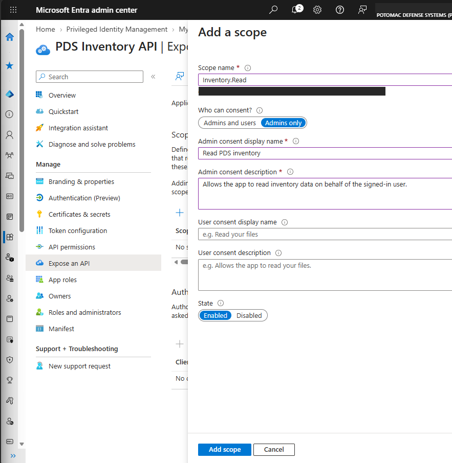

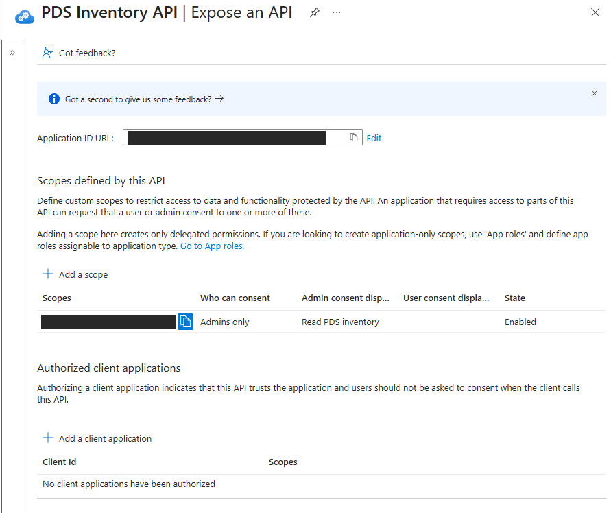

The portal has **no certificate, no client secret and no federated credential**. There's nothing on the device for an attacker to steal and reuse, which is the point of this part:

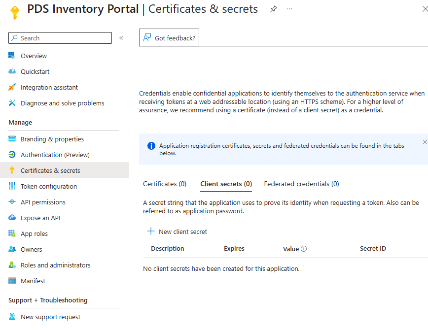

## 2. Consent and permissions

**Tenant consent settings first.** Entra was on **"Let Microsoft manage your consent settings"**, with consent for popular mail clients turned on. Users can still approve some apps on their own. **Illicit consent grants**, where a phishing link asks the user to approve a malicious app, are a common way into mailboxes. I left the setting alone because it doesn't affect this test. It's finding 1.

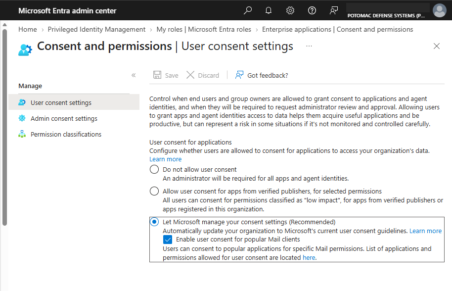

**The portal's permissions:**

| Permission | API | What it's for |
|---|---|---|
| `openid` | Microsoft Graph | Makes it an OIDC sign-in, so an ID token is issued |
| `profile`, `email` | Microsoft Graph | Name, username and email claims in the ID token |
| `offline_access` | Microsoft Graph | A refresh token, for new tokens without a new sign-in |
| `Inventory.Read` | PDS Inventory API | The access token's scope |

New registrations get **`User.Read`** by default. The portal never calls Microsoft Graph, so I removed it before granting consent. I granted **admin consent** once for the whole tenant, so users aren't asked. `Inventory.Read` shows **Admin consent required: Yes** because of its "Admins only" setting:

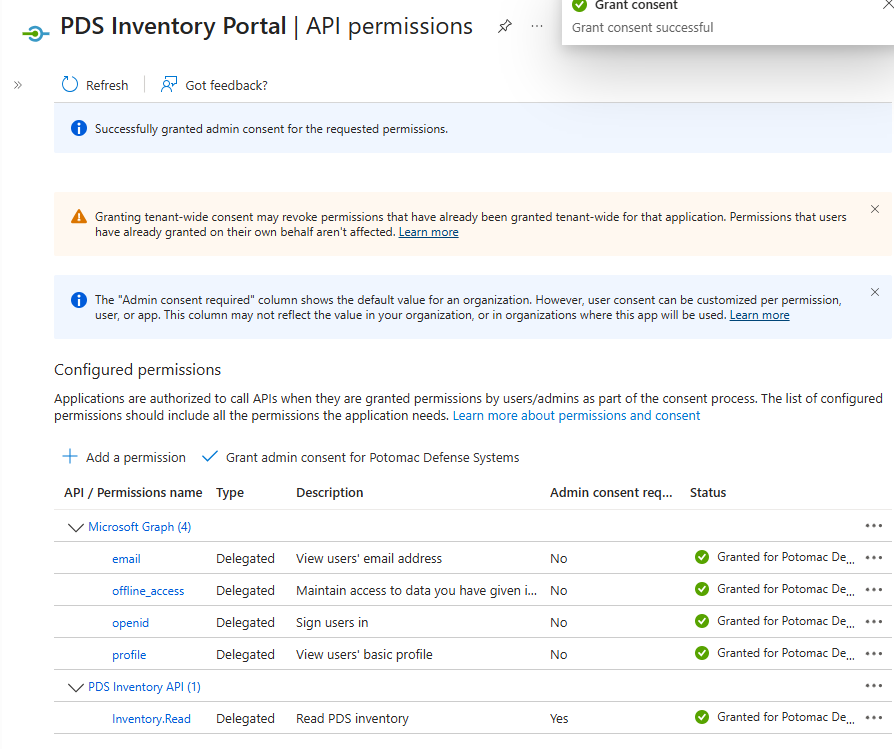

## 3. Who can sign in

An app registration only defines the app. Who can use it is set on its **enterprise application**. I set **Assignment required = Yes** and assigned **Monica only**. Without that, every user in the tenant could sign in. Chris is the refused user in section 7.

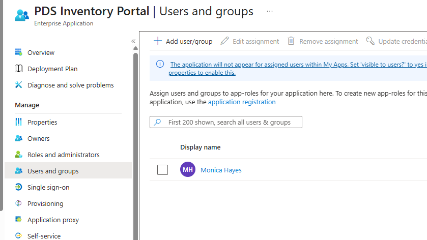

## 4. Signing in with PKCE

I wrote the client in PowerShell so every step of the flow is visible:

| Step | What happens |
|---|---|
| 1 | Generate a random **verifier** (32 bytes) and its SHA-256 hash, the **challenge**. Also a random `state` (stops forged redirects) and `nonce` (stops replayed ID tokens) |
| 2 | Open the authorize URL with the **challenge only**. The verifier never leaves the client |
| 3 | The user signs in. Conditional Access applies as for any app, so Monica completed **MFA** (CA001) |
| 4 | Entra redirects to `http://localhost/?code=…&state=…`. Nothing listens there, so the browser shows an error, but the code is in the address bar |
| 5 | The client checks `state`, then posts the **code + verifier** to the token endpoint. Entra hashes the verifier and compares it to the challenge from step 2 |

**What went wrong first:** I generated the PKCE pair in Cloud Shell and copied the sign-in URL into the workstation. The URL is long and wraps over several lines, and the copy broke it. I moved the whole client onto the workstation instead, which is also more realistic: the device holding the verifier is the one running the browser.

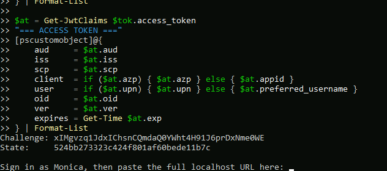

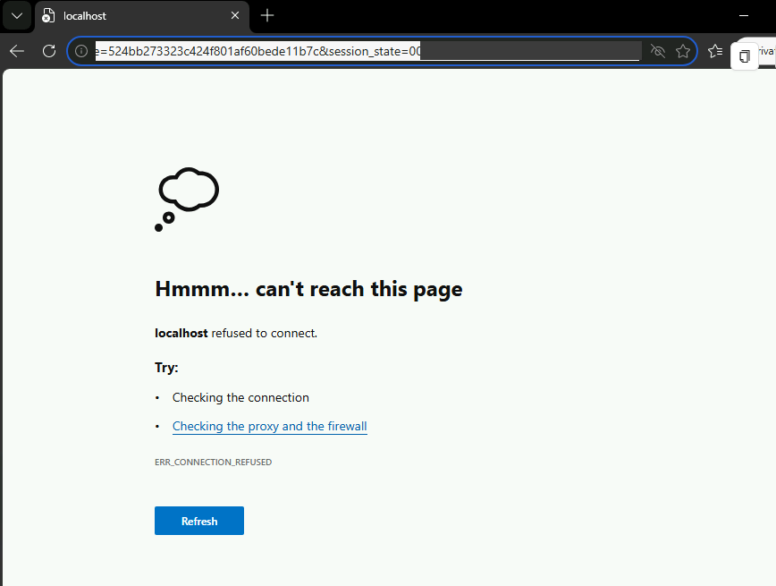

**The second thing that went wrong:** my first exchange used a code from a sign-in about 50 minutes earlier, and Entra refused it as expired (section 7). Codes last minutes, so the final script waits at a prompt for the redirect URL and redeems the code straight away.

## 5. Inside the tokens

The exchange returned three tokens with **no client secret**:

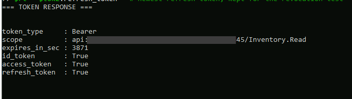

The response's `scope` lists only `Inventory.Read`, because it describes the access token. The OIDC scopes show up as the ID token and refresh token instead. `expires_in` was 3871 seconds: Entra gives access tokens a random lifetime between 60 and 90 minutes.

I decoded both JWTs locally. **Decoding isn't verifying**: anyone can read a token. Only its signature makes it trustworthy, and the receiving app must check that and the audience.

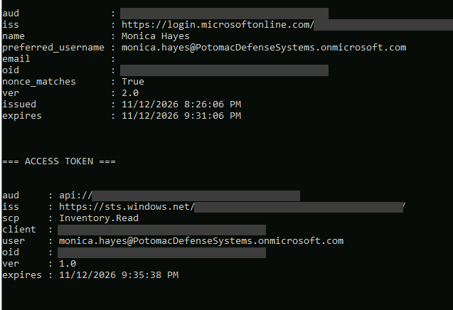

| | ID token | Access token |
|---|---|---|
| **Audience (`aud`)** | The portal's client ID | `api://…`, the Inventory API |
| **Purpose** | Tells the portal who signed in | Lets the portal call the API for Monica |
| **Key claims** | `name`, `preferred_username`, `oid`, `nonce` (matched) | `scp: Inventory.Read`, the portal as the client, Monica as the user |
| **Version** | **2.0** (`login.microsoftonline.com/…/v2.0`) | **1.0** (`sts.windows.net/…`) |

**Same sign-in, two audiences.** The portal shouldn't send the ID token to the API, and the API must reject any token whose `aud` isn't its own.

**Two token versions from one request.** The access token version is set by the **API's** registration, not the endpoint the client called. `requestedAccessTokenVersion` was unset, so Entra issued v1. The API has to validate the v1 issuer format, and v2 is the cleaner target (finding 6).

**`email` is empty.** Monica's AD `mail` attribute was never set by the Project 1 JML engine, the same gap found in 3.4. Any app that keys on the email claim would fail for every PDS user.

## 6. Refresh and revocation

**Refresh:** the refresh token got a new access token with **no browser and no prompt**. The new token still carries `amr: pwd, mfa`, the MFA from the original sign-in. And the refresh token was **rotated**: Entra returned a new one.

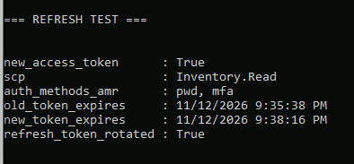

**The old refresh token still worked after rotation.** Rotation hands the client a new token but doesn't cancel the old one. If an attacker copies a refresh token, the real app refreshing normally doesn't lock them out:

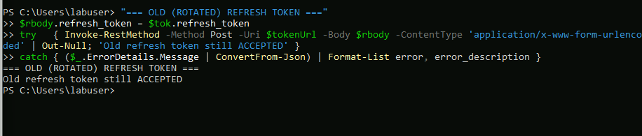

**Revocation** is the off switch. I used **Revoke sessions** on Monica's account, the helpdesk action for a compromised account or a lost laptop:

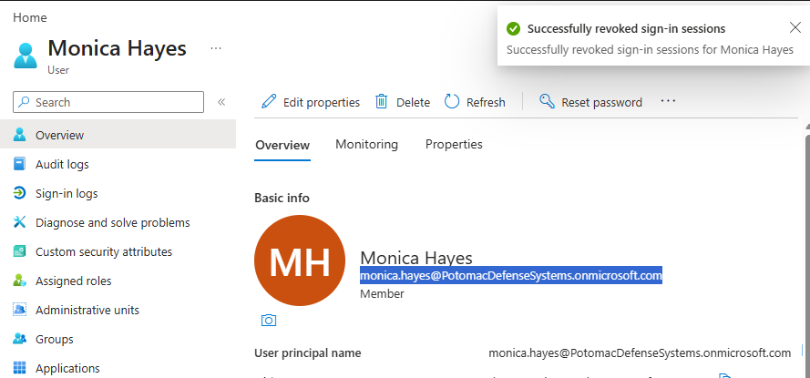

| Time (UTC) | Event |
|---|---|
| 20:37:06 | Sessions revoked. Entra stamps a cutoff on the account: tokens issued earlier are no longer valid |
| **20:37:30** | **The newest refresh token refused, AADSTS50173** (grant revoked) |
| 21:38:16 | When the access token **already issued** actually expires |

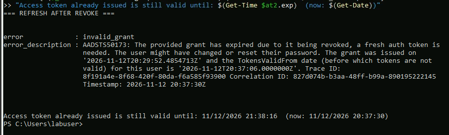

**Revocation took 24 seconds for refresh tokens, but the access token outlives it by about an hour.** It's a bearer token. An API that checks only the signature and the expiry keeps accepting it. Continuous Access Evaluation closes that gap for Microsoft APIs such as Graph and Exchange, but the sign-in log shows **Continuous access evaluation: No** for this app (finding 9).

## 7. Attacks that should fail

**An expired code:** that first exchange, about 50 minutes after sign-in:

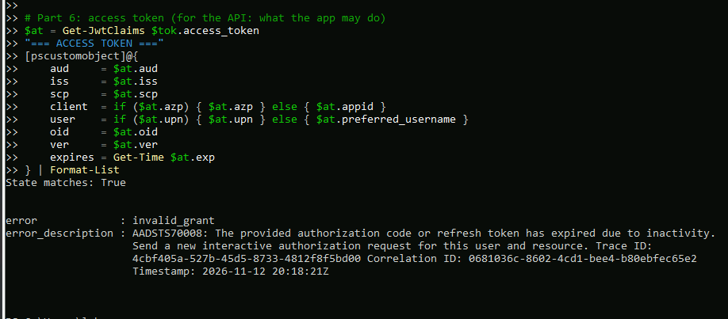

**My first reuse test proved less than I meant it to.** I sent a redeemed code again about 9 minutes after sign-in and got **AADSTS70008 (expired)**, not "already redeemed". The code had timed out before Entra checked whether it was used. It was refused, but the test didn't show the one-use rule:

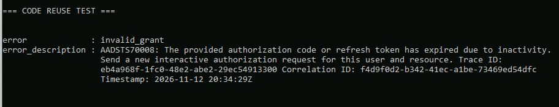

**So I redid it properly:** one fresh sign-in, three requests within one second:

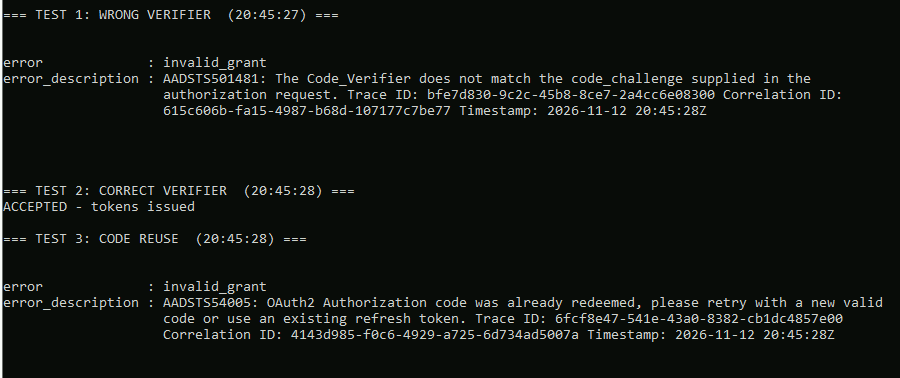

| Time (UTC) | Request | Result |
|---|---|---|
| 20:45:27 | The code with a **wrong verifier**, like an attacker who intercepted the code | ❌ **AADSTS501481**: the verifier doesn't match the challenge |
| 20:45:28 | The same code, **correct verifier** | ✅ Tokens issued. A failed attempt doesn't burn the code, which is fine: a 256-bit verifier can't be guessed |
| 20:45:28 | The same code **again** | ❌ **AADSTS54005**: already redeemed |

**An unassigned user:** Chris has a valid account, but he isn't assigned to the portal. Entra refused him **before issuing a code**, so there was nothing to intercept or exchange:

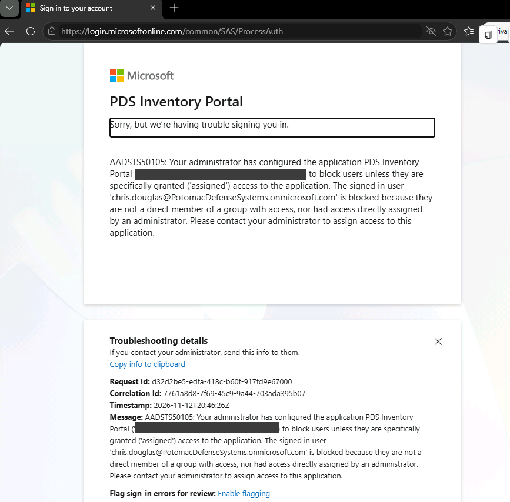

**The sign-in log shows the refusal**, but it wasn't there 15 minutes later and only appeared when I checked again about 45 minutes after the attempt. Two of my successful sign-ins as Monica were missing from the log at first too:

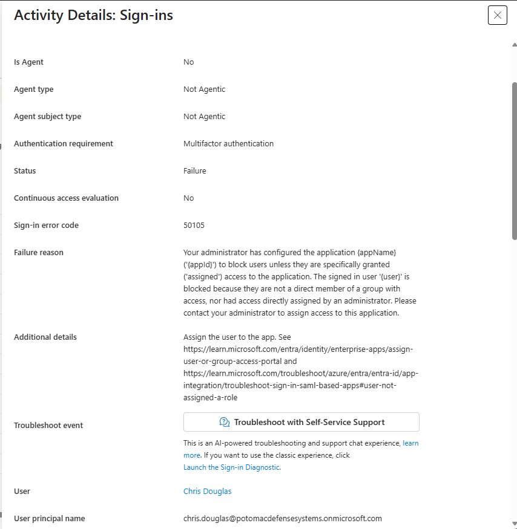

## 8. Findings

| # | Finding | Impact | Fix |
|---|---|---|---|
| 1 | **User consent is Microsoft-managed, with consent for popular mail clients on** | Users can approve some apps' access to their data themselves, the opening for illicit consent phishing | **Do not allow user consent**, plus the **admin consent workflow** so users can request apps (open) |
| 2 | **New app registrations get `User.Read` by default** | An unused permission on every new app | Removed before consent (done). Review default permissions on every registration |
| 3 | **Without "assignment required", any user in the tenant can sign in to a new app** | App access doesn't follow job need | Assignment required, Monica only. Chris refused before a code was issued (done) |
| 4 | **A public client can't keep a secret** | Without PKCE, an intercepted code is enough for tokens | PKCE with S256. Wrong verifier refused with AADSTS501481 (done) |
| 5 | **The access token's lifetime is randomized between 60 and 90 minutes** | Anything relying on a fixed expiry is wrong | Read `exp` from the token (done in the script) |
| 6 | **The API issues v1 access tokens while the ID token is v2** | The API must validate two issuer formats, a common cause of validation bugs | Set `requestedAccessTokenVersion` to 2 on the API (open) |
| 7 | **The `email` claim is empty** | Apps keyed on email fail for every user. Same root cause as 3.4 finding 2 | Populate `mail` in the JML joiner (open) |
| 8 | **Rotated refresh tokens keep working** | A copied refresh token survives the real app's normal refreshes | Revoke sessions whenever an account may be compromised. Project 1's leaver process already does it on offboarding. Production: token protection for supported clients (open) |
| 9 | **Revoking sessions doesn't recall an issued access token** | A stolen access token works for up to about an hour after revocation. CAE isn't active for this app | Short token lifetimes or CAE support in custom APIs, and revocation early in incident response (open) |
| 10 | **Refreshed tokens keep the original MFA claim** | A stolen refresh token gives MFA-level access without MFA | A sign-in frequency Conditional Access policy for sensitive apps (open) |
| 11 | **Sign-in log entries took more than 15 minutes to appear** | Alerts and incident timelines built on sign-in logs lag behind events | Account for the delay in alert design and IR timelines (open) |

## Test results

| Test | Result |
|---|---|
| A public client with no secret gets tokens using PKCE | ✅ ID, access and refresh tokens |
| Conditional Access applies to the new app | ✅ `amr: pwd, mfa` |
| The ID token's nonce matches the request | ✅ |
| The access token is limited to the granted scope and the API's audience | ✅ `scp: Inventory.Read`, `aud` = the API |
| Wrong verifier refused | ✅ AADSTS501481 |
| A code works only once | ✅ AADSTS54005 |
| An expired code refused | ✅ AADSTS70008 |
| An unassigned user refused before any code | ✅ Chris, AADSTS50105, in the sign-in log |
| Refresh works with no prompt | ✅ |
| Revoking sessions kills refresh tokens | ✅ AADSTS50173, 24 seconds after revocation |
| Revoking sessions kills the issued access token | ❌ Valid for about another hour. Finding 9 |

## What I had at the end of 3.6

- [x] An OIDC/OAuth app and API in Entra ID, with no client secret anywhere
- [x] PKCE proven against a wrong verifier, a reused code and an expired code
- [x] Access limited to an assigned user, refused at Entra before any code exists
- [x] The tokens decoded and explained, including what revocation does and doesn't stop

---

**Next:** 3.7 Provisioning · [← Back to the project overview](../../README.md)
