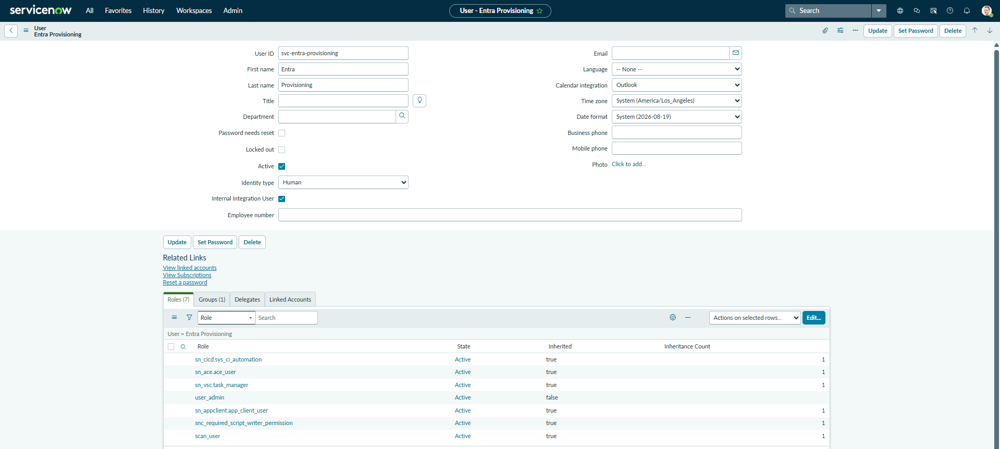
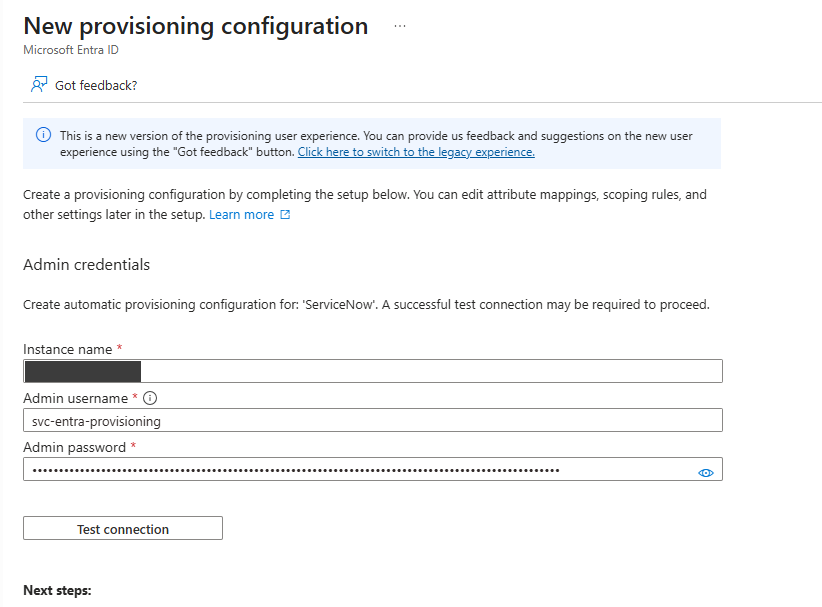
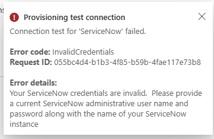
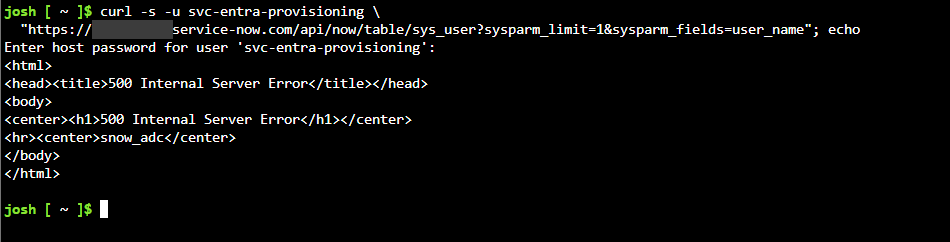
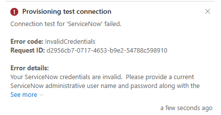
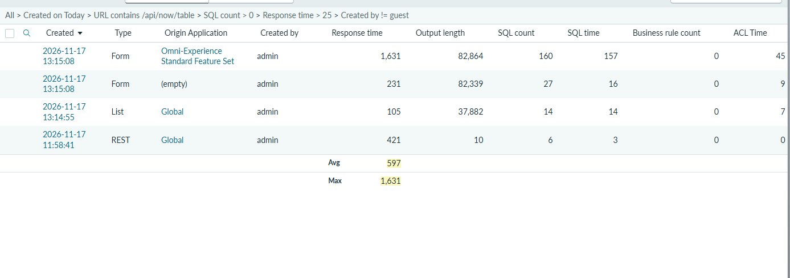
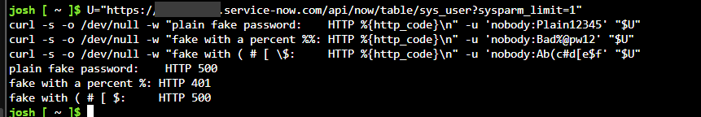

# Part 3.7: Provisioning to ServiceNow (Attempted, Blocked)

[← 3.6 OIDC and OAuth](../3.6-oidc-oauth/README.md) · **3.7** · [3.8 Certificate-based authentication →](../3.8-cba-and-review/README.md)

> **In this part:** I set out to have Entra ID create, update and disable ServiceNow accounts automatically. It didn't work. Entra could never authenticate to ServiceNow's API. I traced the failure to ServiceNow's front door, ruled out my own theories one test at a time, and found the most likely cause: ServiceNow now blocks password-based API access by default. I stopped there and documented it, with the fix I'd use in production.
>
> **Status: ⚠️ Blocked.** Provisioning was not completed. Everything below is what I actually saw.

| # | Section | The lesson |
|---|---|---|
| 1 | [The plan](#1-the-plan) | |
| 2 | [The provisioning account](#2-the-provisioning-account) | The "least privilege" role brings six more with it |
| 3 | [Entra can't connect](#3-entra-cant-connect) | One error message for every kind of failure |
| 4 | [Narrowing it down](#4-narrowing-it-down) | Test the integration path, not the website |
| 5 | [The likely cause](#5-the-likely-cause) | A vendor security change, rolled out quietly |
| 6 | [Why I stopped, and what's still exposed](#6-why-i-stopped-and-whats-still-exposed) | |
| 7 | [Findings](#7-findings) | |

---

## 1. The plan

| Piece | Design |
|---|---|
| Who gets an account | Members of `GG-App-ServiceNow`, the same group that controls SSO since 3.4 |
| How accounts are matched | **employeeID → Employee number**, the same identifier as the SAML sign-in, so Monica's hand-made account would be matched instead of duplicated |
| Tests | Joiner (Chris added to the group), mover (title change), leaver (removed from the group, account disabled) |
| Entra's access to ServiceNow | A dedicated service account with the smallest role that works |

## 2. The provisioning account

`svc-entra-provisioning`, marked as an **integration user** so it can only call the API and never sign in to the UI. Microsoft's tutorial gives this account **`admin`**, full control of the instance. I started with **`user_admin`** instead, which only manages users.

`user_admin` was the only role I assigned, but the account shows **seven**. The other six are **inherited**, including `snc_required_script_writer_permission`. A role's name isn't its whole scope.

Creating the account needed the same workaround as 3.4: with SSO on, the admin's local sign-in is a restricted account recovery session that can't manage users. I briefly turned SSO and account recovery off.

## 3. Entra can't connect

Entra's ServiceNow connector asks for the instance name, a username and a password:

Every **Test connection** failed with the same error:

`InvalidCredentials` and *"provide a current ServiceNow administrative user name and password"* could mean a wrong password **or** a role that isn't enough. Entra gives one message for both, so I tested the API directly from Cloud Shell, read-only, with the password entered at a hidden prompt.

## 4. Narrowing it down

| Test | Result | What it ruled out |
|---|---|---|
| Service account, API call | **401** | Sign-in rejected. The password had never been saved in ServiceNow. Fixed |
| Same, after saving the password | **500**, from `snow_adc` | Not a password problem any more |
| No credentials at all | **401** (normal) | The instance is up and answering |
| Without the integration-user flag | 500 | Not the flag |
| With SSO and account recovery switched off | 500 | Not SSO |
| As the instance admin, SSO off | 500 | Not the service account: **every** signed-in API call failed |

**`snow_adc` is ServiceNow's load balancer, not the instance.** The error page came from in front of the instance. That instance had also struggled to wake up that morning, so I replaced it with a new one. **The new instance behaved exactly the same**, which ruled out instance health:

**Did the requests reach the instance at all?** Its transaction log for the day showed one API request and my own page views. **None of the failed API calls were there**, so they were rejected before reaching it, and nothing about them could appear in the instance's logs:

**Two theories of my own, both wrong:**
1. **Pasted control characters in the password.** A typed password still failed, so I dropped it
2. **Special characters such as `%` in the password breaking the request.** I tested with a **made-up account** and three fake passwords: plain, with `%`, and with other symbols. The results were **500, 401, 500**. The same fake account got different answers, so the password's content wasn't the cause

## 5. The likely cause

ServiceNow is phasing in a control called **Basic Authentication Account Security**, instance by instance. **API sign-ins with a username and password are refused unless the account holds the `snc_basic_auth_api_access` role.** A ServiceNow community thread describes the same pattern on a new developer instance: the admin password works in the browser, every curl call fails, and adding that role fixed it ([ServiceNow Community](https://www.servicenow.com/community/developer-forum/curl-command-to-my-pdi-get-quot-user-is-not-authenticated-quot/m-p/3574529)).

It fits what I saw: browser sign-in worked, API sign-in failed on two instances for every account, and the failed requests never reached the instance. **I didn't test the fix.** It's the most likely cause, not a proven one.

## 6. Why I stopped, and what's still exposed

**Why:** most of a day of troubleshooting had gone into one connection, the Entra ID P2 trial this project depends on ends in two weeks, and 3.8 needs it. The diagnosis is the valuable part, and a confirmed fix wouldn't change the design.

**What I'd do in production:**
1. Grant `snc_basic_auth_api_access` to **this one account only**, keep it on `user_admin`, use a long password stored only in Entra, and rotate it
2. Better: authenticate with **OAuth** instead of a password, if the connector supports it
3. Either way, **test the API path first**, with one read-only call, before configuring anything else

**What's still exposed without provisioning:**
- **Joiners:** ServiceNow accounts are still created by hand (3.4 finding 8 stays open)
- **Leavers:** removing someone from `GG-App-ServiceNow` **does** block their SSO sign-in, because Entra refuses unassigned users (3.5). But **their ServiceNow account stays active**. That's an orphaned account: no access today, still a target for anything that doesn't go through SSO

## 7. Findings

| # | Finding | Impact | Fix |
|---|---|---|---|
| 1 | **ServiceNow now refuses password-based API sign-ins by default**, unless the account has `snc_basic_auth_api_access`. Entra's ServiceNow connector signs in with a password | Provisioning can't connect. Any integration using a password breaks the same way as the control rolls out | Grant the role to the provisioning account only (untested), or use OAuth (open) |
| 2 | **Both sides gave misleading errors**: Entra said `InvalidCredentials` for everything, and ServiceNow's load balancer returned a bare 500 that never reached the instance's logs | Hours spent on the wrong layer | Test the API directly and check the transaction log before changing settings (done) |
| 3 | **An instance can look healthy in the browser while its API path fails** | Building on an integration that can never work | Make one read-only API call before configuring an integration (done) |
| 4 | **`user_admin` silently brings six more roles** | "Least privilege" by role name isn't least privilege | Review inherited roles for every service account (open) |
| 5 | **Creating the service account meant switching SSO off again** | Routine admin work keeps weakening the SSO setup temporarily (3.4 finding 4) | Do admin setup before enabling SSO, or use a separate admin path (open) |
| 6 | **Without provisioning, leavers keep active ServiceNow accounts** | Orphaned accounts: blocked at SSO, but still present | Provisioning once connected, or a periodic reconciliation of `GG-App-ServiceNow` against active ServiceNow users (open) |

## Test results

| Test | Result |
|---|---|
| Entra connects to ServiceNow | ❌ `InvalidCredentials`, two instances |
| Signed-in API call from Cloud Shell | ❌ 500 from ServiceNow's load balancer, every account, SSO on or off |
| Unauthenticated API call | ✅ 401, as expected |
| Failed calls recorded by the instance | ❌ Not present: rejected before reaching it |
| Joiner, mover, leaver | Not run |

---

**Next:** [3.8 Certificate-based authentication](../3.8-cba-and-review/README.md) · [← Back to the project overview](../../README.md)
